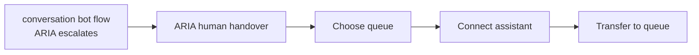
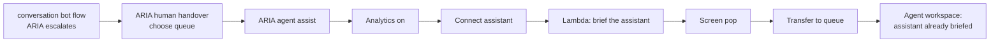

# ARIA Agent Assist — Complete Novice Guide

Sets up the AI assistant that a **human agent** sees in the Amazon Connect agent workspace, so that
when a customer is handed over from ARIA the assistant already knows who they are, what ARIA did,
and what the agent should do first.

It is kept **separate from the bot flow**. Nothing in `conversation bot flow` changes.

> **Nothing in this folder has been deployed.** The code is unit-tested on a laptop only. You create
> the Lambda, the flow and the prompt in AWS yourself by following Parts B to E. The design is in
> [SPEC.md](SPEC.md).

---

## Table of Contents

- [1. Concepts You Must Understand First](#1-concepts-you-must-understand-first)
- [2. What You Have Today and What Changes](#2-what-you-have-today-and-what-changes)
- [3. What Is in This Folder](#3-what-is-in-this-folder)
- [4. Prerequisites](#4-prerequisites)
- [Part A — Run the Tests on Your Laptop](#part-a--run-the-tests-on-your-laptop)
- [Part B — Deploy the Context Lambda](#part-b--deploy-the-context-lambda)
- [Part C — Update the Agent-Assist AI Agent](#part-c--update-the-agent-assist-ai-agent)
- [Part D — Create the Agent Assist Flow](#part-d--create-the-agent-assist-flow)
- [Part E — Point the Handover Flow at It](#part-e--point-the-handover-flow-at-it)
- [Part G — Brief the Agent on Arrival](#part-g--brief-the-agent-on-arrival-without-typing)
- [Part H — Make the Briefing Faster](#part-h--make-the-briefing-faster-with-a-dedicated-briefing-agent)
- [Part F — Test It](#part-f--test-it)
- [Reference: What the Assistant Is Told](#reference-what-the-assistant-is-told)
- [Understanding Every Block You Used](#understanding-every-block-you-used)
- [Troubleshooting](#troubleshooting)
- [How to Undo It](#how-to-undo-it)

---

## 1. Concepts You Must Understand First

### Two different AI agents

Your instance has two AI agents that are easy to confuse.

| | ARIA | Agent assist |
|---|---|---|
| AI agent name | `my-conversation-agent` | `my-agent-assistant-agent` |
| Who it talks to | The **customer** | The **human agent** |
| Where it appears | On the phone or in the chat | A side panel in the agent workspace |
| What it does | Answers the customer | Suggests what the agent should do next |
| Lives in which flow | `conversation bot flow` | The flow you build here |

This guide is only about the second one.

### Agent assist is not a flow agents "run"

There is no agent-assist flow that an agent opens. Agent assist is **switched on for a contact** by
one flow block, called **Connect assistant**, placed before the contact is put in a queue. When an
agent accepts that contact, the assistant panel is already attached to it.

### What "proactive" means here

The assistant watches the conversation as it happens and offers a suggestion without being asked.
For that it needs a live transcript, which Amazon Connect produces only when **conversational
analytics** is switched on for the contact:

- **Calls:** real-time analytics must be on. Without it the assistant stays silent on calls.
- **Chats:** chat analytics must be on.

### A session, and why the Lambda has two jobs

An AI agent works inside a **session**: a notebook for one contact. A contact has **one session for
its whole life**. The bot flow creates it and names ARIA as the AI agent that drives it.

That causes two problems when a human takes over:

1. **The session still belongs to ARIA.** Adding a second **Connect assistant** block does not
   change that: Connect hands back the same session with the same agent. The human agent's panel
   would be driven by ARIA's customer-facing agent, and stays silent.
2. **The assistant has no briefing** written for a member of staff.

The small Lambda in this folder fixes both. It switches the session to the agent-assist AI agent,
then writes the briefing: who the customer is, how they were verified, ARIA's summary, and what the
bank already knows about why they may be calling.

### Why the assistant is told more than ARIA

ARIA talks to the customer, so it is only given sensitive details once the customer is verified. The
assistant talks to a member of **staff**, so it is given everything, **plus** a plain statement of
how well the customer was verified. If the customer was only recognised by phone number, the
assistant's first suggestion is to verify their identity.

---

## 2. What You Have Today and What Changes

**Today.** The flow `ARIA human handover` already switches agent assist on. It does five jobs in one
flow: choose the queue, attach the assistant, set the screen pop, play a message, and queue the
contact.



Three things are missing:

1. Real-time analytics is switched on only inside the bot flow. A contact that reaches the handover
   flow any other way gets no proactive suggestions.
2. The assistant starts cold: it is not told anything about the customer or about ARIA's conversation.
3. It can suggest documents and write notes, but cannot look up the customer's accounts.

**After this change.** A new flow, `ARIA agent assist`, does everything to do with the assistant.
The handover flow only chooses the queue and passes the contact on.



Any other route to a human can use the same flow later.

---

## 3. What Is in This Folder

| File | What it is |
|---|---|
| [README.md](README.md) | This guide |
| [SPEC.md](SPEC.md) | The design: decisions, contracts, limits |
| [PROMPT-CHANGES.md](PROMPT-CHANGES.md) | What was added to the assistant's prompt, and why |
| [lambda/aria_agent_assist_injector.py](lambda/aria_agent_assist_injector.py) | The Lambda that briefs the assistant |
| [flows/aria-agent-assist-flow.json](flows/aria-agent-assist-flow.json) | The flow, ready to import |
| [flows/build_flow.py](flows/build_flow.py) | Regenerates the flow JSON, for example for a new agent version |
| [prompts/agent-assist-prompt-v3.yaml](prompts/agent-assist-prompt-v3.yaml) | The complete prompt to paste into Connect |
| [scripts/deploy_agent_assist.sh](scripts/deploy_agent_assist.sh) | Creates the Lambda. **You** run it |
| [tests/test_agent_assist.py](tests/test_agent_assist.py) | 25 unit tests |

---

## 4. Prerequisites

| You need | Why | How to check |
|---|---|---|
| ARIA escalating to a human today | This builds on that path | Ask ARIA for a person and reach a queue |
| An agent user who can log in to the **agent workspace** | The assistant panel only appears there | Open the agent workspace from the Connect admin website |
| The `Agent` security profile | It already has the two permissions needed: view the assistant, and view real-time Contact Lens | Users → Security profiles → Agent |
| AWS CLI v2, signed in to account `395402194296` | To run the deploy script | `aws sts get-caller-identity` |
| Python 3.10 or later and `zip` | Tests and packaging | `python3 --version` |

Values used in this guide. They are already written into the flow JSON.

| Name | Value |
|---|---|
| Region | `eu-west-2` |
| Connect instance | `f969d4b4-f716-4974-a325-bb7899f2f293` |
| Assistant | `e6991ed4-e11c-4194-8d20-13889a36bd15` |
| Agent-assist AI agent | `my-agent-assistant-agent`, currently version 3 |
| Agent-assist prompt | `agent-assistance-promnpt`, currently version 2 |
| Screen pop flow | `ARIA-Agent-Screen-Pop-Flow` |
| New Lambda | `aria-agent-assist-injector` |
| New flow | `ARIA agent assist` |

---

## Part A — Run the Tests on Your Laptop

From the repository root:

```bash
python3 -m unittest discover -s connect-agent-assist/tests -v
```

You should see `Ran 25 tests` and `OK`. A few lines that look like errors are expected: they come
from tests that check the Lambda fails safely.

---

## Part B — Deploy the Context Lambda

This step changes your AWS account. It creates one IAM role and one Lambda function.

```bash
./connect-agent-assist/scripts/deploy_agent_assist.sh --dry-run   # see what it would do
./connect-agent-assist/scripts/deploy_agent_assist.sh             # do it
```

It needs no options: the defaults are your `conversationbot` instance. Run it with `--help` to see
what can be overridden. It uses the AWS CLI only.

The script:

1. Checks your credentials belong to the target account, and stops if they do not.
2. Creates the role `aria-lambda-agent-assist-injector-role`. It can read contacts on this one
   Connect instance and write to this one assistant's sessions. Nothing else.
3. Zips the Lambda **together with** `session_injector_qconnect.py`, because it reads the test
   customers from that file.
4. Creates the Lambda `aria-agent-assist-injector`.
5. Lets your Connect instance invoke it, and adds it to the instance's Lambda allow-list so a flow
   can select it.
6. Invokes it once with a made-up contact to prove the package loads.

> Step 6 cannot prove the permissions are right. Only a real contact going through the flow can.
> Part F checks that.

---

## Part C — Update the Agent-Assist AI Agent

Three changes to `my-agent-assistant-agent`, then one publish.

### Step C.1 — Paste the new prompt

1. Connect admin website → **AI agent designer** → **AI prompts** → `agent-assistance-promnpt`.
2. Select all the text and save a copy as `agent-assist-prompt-v2-backup.txt`.
3. Click **Edit** (or **Create new version**).
4. Replace the whole text with the contents of
   [prompts/agent-assist-prompt-v3.yaml](prompts/agent-assist-prompt-v3.yaml).
5. Check the first line is exactly `system: |` and that `messages:` near the end starts at the left
   edge with no spaces.
6. **Save**, then **Publish**. Note the new version number (it should be 3).

The prompt is your existing one with two additions, and four airline-only passages removed to stay
inside Connect's size limit. [PROMPT-CHANGES.md](PROMPT-CHANGES.md) explains both. Its response
protocol is untouched.

> **If Connect says "System length must not exceed 100000 characters":** the prompt has grown past
> the limit. The file as supplied is 98,919 characters. Check you pasted it once, not twice, and
> that nothing was added.

> **If Connect says "Number of custom variables may not exceed 20":** this prompt uses 12, so it
> should not. If it does, tell whoever maintains this folder which error you got.

### Step C.2 — Add the read-only banking tools

1. **AI agent designer** → **AI agents** → `my-agent-assistant-agent` → **Edit**.
2. In **Tools**, choose **Add tool** and add these eight from the `aria-banking-mcp-gateway-prod`
   integration:

| Tool | Lets the assistant |
|---|---|
| `aria_banking_customer___get_customer_details` | See the customer's profile |
| `aria_banking_account___get_account_balance` | See a balance |
| `aria_banking_account___get_account_details` | See sort code and account number |
| `aria_banking_account___get_recent_transactions` | See recent transactions |
| `aria_banking_debit_card___get_debit_card_details` | See debit card status and limits |
| `aria_banking_credit_card___get_credit_card_details` | See credit card balance and limit |
| `aria_banking_mortgage___get_mortgage_details` | See mortgage details |
| `aria_banking_products___analyse_spending` | Summarise spending |

3. Leave each tool's instruction field empty.
4. Keep the two tools already there, `Retrieve` and `GenerateNotes`.

**Do not add** the tools that change something or verify a customer: `block_debit_card`,
`block_credit_card`, the three `aria_banking_auth___…` tools, or the two push-challenge tools. The
assistant advises; the agent acts.

> The account, customer and auth Lambdas answer only when they have `MOCK_DATA=true`. That was set
> when the payment step-up was deployed. If the assistant says it cannot find the customer, check it.

### Step C.3 — Point the agent at the new prompt and publish

1. Still on the agent's edit page, find the **prompt** setting and choose the version from Step C.1.
2. **Save**, then **Publish**.
3. Note the new **agent version** (it should be 4). You need it in Part D.

Nothing has changed for agents yet. The handover flow still pins version 3.

---

## Part D — Create the Agent Assist Flow

The flow file pins agent version 4. If the version from Step C.3 is different, regenerate the JSON
first:

```bash
python3 connect-agent-assist/flows/build_flow.py --assist-agent-version 4
```

Then choose one method.

### Method 1 — Import the JSON (recommended)

1. Connect admin website → **Routing** → **Flows** → **Create flow** (type *Contact flow (inbound)*).
2. Click the arrow next to **Save** → **Import**.
3. Select `connect-agent-assist/flows/aria-agent-assist-flow.json`.
4. Name the flow `ARIA agent assist`.
5. Check these three blocks show no warning triangle:
   - **Connect assistant** shows your assistant and `my-agent-assistant-agent` at the right version
   - **AWS Lambda function** shows `aria-agent-assist-injector`
   - **Set event flow** shows `ARIA-Agent-Screen-Pop-Flow`
6. **Save**, then **Publish**.

> **If you see an empty "Set contact attributes" block after Connect assistant, and Connect will not
> save:** you imported an older copy of the JSON. Delete that empty block and connect **Connect
> assistant** → **Success** straight to the **AWS Lambda function** block. Nothing needs adding to
> it: the Connect assistant block already records the session.

### Method 2 — Build it block by block

Create a new inbound flow and add these 11 blocks (row 6 is not a block you add). The **Name** column is the label used in the JSON.

> Screen labels were written from the AWS documentation and the flow JSON, not by clicking through
> your console, so a label may differ slightly. The block types and values are what matter.

| # | Name | Block type | Settings | Connect its branches to |
|---|---|---|---|---|
| 1 | EnableLogging | Set logging behavior | **Enable** | → 2 |
| 2 | CheckChannel | Check contact attributes | Namespace **System**, key **Channel**. One condition: *Equals* `CHAT` | `CHAT` → 4. No match → 3 |
| 3 | VoiceAnalytics | Set recording and analytics behavior | Channel **Voice**. Recording on for agent and customer. Analytics **on**, language *English (UK)*, **Real-time and post-call**. Sentiment on | Success and Error → 5 |
| 4 | ChatAnalytics | Set recording and analytics behavior | Channel **Chat**. Analytics **on**, language *English (UK)*. Sentiment on | Success and Error → 5 |
| 5 | ConnectAssistant | Connect assistant | Your assistant domain. Under the AI agent setting choose `my-agent-assistant-agent` and the version from Step C.3 | Success → 7. Error → 8 |
| 6 | SetAssistantSession | *(none: part of block 5)* | Nothing to add. **Connect assistant** records the session on the contact itself; the designer does not show this as a block | |
| 7 | InjectContext | AWS Lambda function | Function `aria-agent-assist-injector`. Timeout **8**. Response validation **STRING_MAP**. One parameter: key `assistAgentArn`, value the full ARN of the agent version from Step C.3 (see below) | Success and Error → 8 |
| 8 | SetAgentScreen | Set event flow | Event **Default flow for agent UI**, flow `ARIA-Agent-Screen-Pop-Flow` | Success and Error → 9 |
| 9 | SetQueue | Set working queue | Set dynamically: namespace **User defined**, key `ariaQueueId` | Success and Error → 10 |
| 10 | TransferToQueue | Transfer to queue | | At capacity and Error → 11 |
| 11 | QueueProblem | Play prompt | Text: `I'm sorry, I wasn't able to connect you to a colleague just now. Please try again shortly.` | Success and Error → 12 |
| 12 | Disconnect | Disconnect | | |

**The rule behind the arrows.** Blocks 3 to 9 send their **Error** branch onward, never to
Disconnect. If analytics, the assistant or the Lambda fails, the customer must still reach a person.
Only a failure to queue ends the contact.

**The Lambda parameter in block 7.** Add a parameter with **Set manually**, key `assistAgentArn`,
and this value, changing the last number to your agent version:

```
arn:aws:wisdom:eu-west-2:395402194296:ai-agent/e6991ed4-e11c-4194-8d20-13889a36bd15/26ca6380-17fe-4828-bc53-537e1154ecbb:4
```

The Lambda switches the contact's session to that agent. Without it the panel shows a greeting and
nothing else. When you publish a new agent version later, change the number here **and** in the
Connect assistant block.

**Order matters for blocks 5, 6 and 7.** The Lambda finds the session to write to by asking Connect
for the contact's current assistant session. Block 5 creates and records it. If block 7 runs
first, there is nothing to write to.

**Save**, then **Publish**.

---

## Part E — Point the Handover Flow at It

**This is the step that changes live contacts.** Until now nothing an agent sees has changed.

### Before you edit

Open `ARIA human handover`, click the arrow next to **Save** → **Export flow**, and keep the file.
That is your way back.

### What the flow looks like now

```
Lambda: aria-routing-lookup
  → Connect assistant
  → Set contact data (assistant session)
  → Play prompt: "Please wait while i connect you to one of my colleague."
  → Set working queue            ← from the Lambda's queueId
  → Set contact attributes       ← ariaSummary, ariaTopicCategory, ariaEscalationReason, ariaCustomerIntent
  → Set event flow               ← screen pop
  → Transfer to queue
```

### What to change

1. **Delete** these four blocks. The new flow does their jobs:
   - **Connect assistant**
   - **Set contact data** (the one straight after it)
   - **Set event flow**
   - **Transfer to queue**
2. **Reconnect** the Lambda block's **Success** branch to the **Play prompt** block.
3. In the **Set contact attributes** block, **add one attribute**: destination key `ariaQueueId`,
   set dynamically from namespace **External**, key `queueId`.
4. **Add** a **Transfer to flow** block and choose `ARIA agent assist`. Connect the **Set contact
   attributes** block's **Success** branch to it, and its own **Error** branch to the existing
   Disconnect block.

### What it should look like afterwards

```
Lambda: aria-routing-lookup
  → Play prompt: "Please wait while i connect you to one of my colleague."
  → Set working queue            ← from the Lambda's queueId
  → Set contact attributes       ← the four as before, plus ariaQueueId
  → Transfer to flow: ARIA agent assist
```

**Save**, then **Publish**.

> **Why add `ariaQueueId`?** The queue is chosen here and used in the new flow. Passing it as an
> attribute means the new flow does not depend on the working queue surviving the move between
> flows. If the attribute is missing, the new flow carries on with the working queue already set.

---

## Part G — Brief the Agent on Arrival, Without Typing

**What the Connect assistant panel can and cannot do.** It shows two things: an answer to a question
the agent types, and a suggestion the agent clicks once the customer has said what they want. It
does not speak when a contact arrives, and it does not display an answer to a question something
else asked. That was tested on a live contact: the assistant wrote a full briefing, and the panel
showed none of it.

So the arrival briefing goes in the **screen pop**, which is yours to design. It gains five lines:

| Line on the screen pop | Where it comes from | When it is there |
|---|---|---|
| **Verification** | The Lambda: how the customer was verified and what that allows | At once |
| **Likely reasons** | The Lambda: what the bank already knows may be behind the contact | At once |
| **Do first** | The assistant | About twenty seconds after the transfer |
| **Product details** | The assistant, from a look-up of the product the contact is about | About twenty seconds after the transfer |
| **Related guidance** | The assistant, from your knowledge base | About twenty seconds after the transfer |

### How it works

1. When the contact is transferred, the Lambda asks the assistant the opening question on the
   agent's behalf and returns at once. The assistant works on it while the customer is in the queue.
2. When the agent accepts, the screen-pop flow calls the same Lambda (parameter `operation` =
   `get_briefing`). It reads the assistant's answer from the session and returns the five lines.
3. **Refresh briefing** calls it again, for when the agent accepted before the assistant finished.

Nothing is stored on the contact. The screen pop runs under its own contact ID, so it cannot rely on
attributes set on the original contact after it opened. Both share the assistant session.

### Steps

1. Run the deploy script again. It updates the Lambda, and copies the `CLI_MATCH_LOA` setting from
   ARIA's injector so the agent is told the same verification level ARIA was told.
2. Open `ARIA-Agent-Screen-Pop-Flow`. Click the arrow next to **Save** → **Export flow** and keep
   the file as your way back.
3. In the same flow, click the arrow next to **Save** → **Import**, and select
   `connect-agent-assist/flows/aria-agent-screen-pop-flow.json`. This replaces the flow's blocks.
4. Check the **AWS Lambda function** block shows `aria-agent-assist-injector` with no warning.
5. **Save**, then **Publish**.

Nothing changes in `ARIA agent assist`.

### What the agent sees

The usual handoff summary with the five lines under it, and two controls:

- **Refresh briefing** (a button) fetches the lines again and shows the view again.
- **Got it** (the view's back link) closes the screen pop.

### How to check it worked

| Where to look | What you should see |
|---|---|
| Log group `/aws/lambda/aria-agent-assist-injector` | `"briefing": "requested"` on the contact's line, then `"status": "briefing_read"` each time the screen pop opens or refreshes, with `"ready": "true"` once the assistant has answered |
| Log group `/aws/connect/conversationalbot` | The screen-pop flow's blocks |

> **Why one button and one link.** A view reports a pressed button only as "a button was pressed".
> Telling two buttons apart needs a deeper path that the designer's **Check contact attributes**
> block will not accept (it reports a missing parameter). A button and the back link are two
> separate branches of the **Show view** block, so no check is needed.
>
> Separately, the briefing once showed the assistant's progress note ("Getting James's mortgage
> details together now") instead of its answer. Only a formatted answer is accepted now.

To switch the briefing off without touching a flow, set the Lambda's `BRIEFING_ENABLED` to `false`.
The wording of the question is `ARRIVAL_BRIEFING_REQUEST` in the Lambda.

---

## Part H — Make the Briefing Faster with a Dedicated Briefing Agent

**Why it is slow.** Measured on a live contact, the briefing took 22 seconds: 7 for the model to
read its instructions and choose its look-ups, under 1 for the look-ups, and 14 to write. The
agent-assist prompt is about 29,000 tokens and runs on a large model, and both model turns pay
for that.

**The fix.** A second AI agent that only writes the arrival briefing: a prompt of a few hundred
words, on the fast Haiku model, with a fixed three-line answer. The Lambda sends the opening
question to that agent instead. The agent in the Connect assistant panel is unchanged.

Expect a few seconds instead of twenty. That figure is an estimate until you test it.

### Step H.1 — Create the briefing prompt

1. Connect admin website → **AI agent designer** → **AI prompts** → **Create AI prompt**.
2. Type: **Orchestration**. Name: `agent-briefing-prompt`.
3. Model: **Claude Haiku 4.5** (the newest Haiku in the list).
4. Replace the whole text with the contents of
   [prompts/agent-briefing-prompt-v1.yaml](prompts/agent-briefing-prompt-v1.yaml).
5. **Save**, then **Publish**.

### Step H.2 — Create the briefing agent

1. **AI agent designer** → **AI agents** → **Create AI agent**.
2. Type: **Orchestration**. Name: `my-agent-briefing-agent`. Locale: English (UK).
3. Prompt: `agent-briefing-prompt`, the version you just published.
4. Add these five tools and no others. Fewer tools means less for the model to read:

| Tool | Used for |
|---|---|
| `Retrieve` | The related guidance, from your knowledge base |
| `aria_banking_mortgage___get_mortgage_details` | A mortgage contact |
| `aria_banking_account___get_account_balance` | An account or payment contact |
| `aria_banking_debit_card___get_debit_card_details` | A debit card contact |
| `aria_banking_credit_card___get_credit_card_details` | A credit card contact |

5. **Save**, then **Publish**. On the agent's page, copy its **ARN** and note the **version**.

### Step H.3 — Tell the flow to use it

Open `ARIA agent assist`, click the **AWS Lambda function** block, and add a second parameter:

- **Key:** `briefingAgentArn` (set manually)
- **Value:** the agent's ARN followed by a colon and the version, for example
  `arn:aws:wisdom:eu-west-2:395402194296:ai-agent/e6991ed4-e11c-4194-8d20-13889a36bd15/<agent-id>:1`

**Save**, then **Publish**. Run the deploy script once so the Lambda has the matching code.

### How to check it worked

| Where to look | What you should see |
|---|---|
| Log group `/aws/lambda/aria-agent-assist-injector` | `"briefing": "requested_fast"` on the contact's line. Plain `"requested"` means the parameter was not passed |
| The screen pop | The three assistant lines filled in a few seconds after the transfer |

**To go back**, delete the `briefingAgentArn` parameter and publish. The agent-assist agent writes
the briefing again, slowly.

> **Not yet proven on a live contact.** Two things to watch: whether Connect accepts a question
> addressed to an agent other than the one set on the session, and whether Haiku follows the
> three-line format. If the three lines stay on "still preparing", say so and I will read the
> session to see which it was.

---

## Part F — Test It

You need two people, or one person with a phone and a browser: a **caller** and an **agent** logged
in to the agent workspace, available, and in a routing profile that serves the queue. Tests 1 and 2
both route as a current-account query, so the agent needs the **Retail Banking** queue.

> **Use a current-account question, not a mortgage one, for these tests.** ARIA labels a mortgage
> escalation `mortgage`, but the routing table's key is `mortgages`. The routing Lambda finds no
> queue, and the handover flow disconnects the contact before this new flow ever runs. That is an
> existing routing mismatch, not an agent-assist fault. Fix it by making the two spellings agree.

### Test 1 — Handover with a briefing

1. Agent: log in to the agent workspace and set yourself **Available**.
2. Caller: ring the ID&V test harness number and quick-select James (`1`, `1`).
3. Caller: ask ARIA for your balance, then say "I'd like to speak to someone".
4. Agent: accept the contact.

**Expected.** The assistant panel is open on the contact. When the customer next speaks, or when you
type a question, the first suggestion tells you what to do first, mentions what ARIA already did,
and offers the related guidance.

### Test 2 — An approved payment

1. Caller: quick-select James, ask to make a payment, give a payee and amount, and say back the
   number ARIA reads out.
2. Agent: accept the contact.

**Expected.** The assistant's suggestion is to make that payment, names the payee and amount, says
to read both back to the customer first, and says the customer must not be asked to approve it again.

### Test 3 — A customer who was not verified

1. Caller: ring the **main** number directly from a number the injector recognises.
2. Caller: ask to speak to someone.
3. Agent: accept the contact.

**Expected.** It depends on how ARIA's injector treats a recognised phone number:

- **`CLI_MATCH_LOA` is set on `aria-session-injector-qconnect`** (it is `3` on this instance): the
  assistant says the customer is verified by one check at that level, that account information
  can be discussed, and that a payment or a change of details needs the agent's own further
  verification.
- **It is not set:** the assistant's first suggestion is to verify the customer's identity.

### Test 4 — Chat

Start a chat that reaches ARIA, ask for a person, and accept it as the agent. The same briefing
should appear, with suggestions as the customer types.

### Checking it worked behind the scenes

| Where to look | What you should see |
|---|---|
| **CloudWatch → Log groups → /aws/lambda/aria-agent-assist-injector** | One line per contact with `"status": "injected"` and the list of keys written |
| **CloudWatch → /aws/connect/conversationalbot**, filtered by the contact ID | The `ARIA agent assist` flow running its blocks in order, ending in the queue transfer |
| **Contact search → your contact → Attributes** | `ariaQueueId`, `ariaSummary`, `ariaTopicCategory` |

### Two things this guide cannot promise

These depend on how Amazon Connect behaves on a live contact, and were not tested:

- **How early the first suggestion appears.** The assistant reacts to the conversation. It may wait
  for the customer's first sentence to the agent before it speaks. If you need the briefing the
  instant the contact connects, the screen pop is the reliable place for it.
- **Whether the assistant can see what the customer said to ARIA.** It is given ARIA's summary, which
  does not depend on that.

---

## Reference: What the Assistant Is Told

Written into the assistant's session by the Lambda. In the prompt each appears as `{{$.Custom.<name>}}`.

| Name | Example | Where it comes from |
|---|---|---|
| `customerId` | `CUST-001` | Contact attribute `customerId` |
| `preferredName` | `James` | The injector's customer record |
| `productSummary` | `James has a current account ending 4821…` | The injector's customer record |
| `channel` | `voice` | The contact |
| `verification` | `Strongly verified by an approval in the banking app. No further identity check is needed for servicing.` | Contact attributes `LoA` and `idvMethod` |
| `paymentApproved` | `true` | ARIA's summary starts "Level 4 payment step-up passed" |
| `ariaCustomerIntent` | `Discuss overpayment allowance` | `ariaCustomerIntent`, else `customerIntent` |
| `ariaTopicCategory` | `mortgage` | `ariaTopicCategory`, else `topicCategory` |
| `ariaEscalationReason` | `complex_request` | `ariaEscalationReason`, else `escalationReason` |
| `ariaSummary` | `Customer asked about a lump-sum overpayment…` | `ariaSummary`, else `conversationSummary` |
| `knownContactReasons` | `(1) trouble signing in to the mobile app: …; (2) …` | The injector's known contact reasons |
| `vulnerabilityContext` | JSON of flags, or empty | The injector's customer record |

How `verification` is worded:

| Situation | The assistant is told |
|---|---|
| Level 3 from a real check | Strongly verified. No further identity check needed |
| Level 2 | Verified by one check. Fine for account information, not for payments |
| Direct call, recognised by phone number, and ARIA's injector gives that a level (`CLI_MATCH_LOA`) | Verified by one check at that level. Fine for account information; payments and changes need the agent's own further verification |
| Recognised by phone number only, no level given | Not verified. Verify identity before discussing the account |
| No ID&V recorded, or level 0 or 1 | Verify identity before discussing the account |

---

## Understanding Every Block You Used

### Set logging behavior
Writes each block's result to CloudWatch Logs, so you can see where a contact went.

### Check contact attributes
A fork. Here it sends chats one way and calls the other, because the analytics block needs
different settings for each.

### Set recording and analytics behavior
Switches on recording and conversational analytics. For calls, **real-time** analytics is what
produces the live transcript the assistant reads. The bot flow already switches it on, so for
contacts coming from ARIA this block repeats it. It is here so the flow works whatever sent the
contact.

### Connect assistant
Attaches your assistant to the contact. For a contact that came from ARIA the session already
exists, so this block returns that same session and does not change its AI agent. The Lambda does
that.

### Set contact data (inside Connect assistant)
Records the session on the contact. The agent workspace and the Lambda both find the session
through the contact. You never add this yourself: the designer builds it into the **Connect
assistant** block, which is why the flow file has 12 steps but the designer shows 11 blocks.

### AWS Lambda function
Runs `aria-agent-assist-injector`, which writes the briefing into the session.

### Set event flow
Chooses the screen pop the agent sees when the contact arrives.

### Set working queue
Chooses which queue the contact joins.

### Transfer to queue
Puts the contact in the queue. The flow ends here for a successful contact.

### Play prompt and Disconnect
Used only if the contact cannot be queued.

---

## Troubleshooting

### The assistant panel does not appear

- The agent must use the **agent workspace**, not the plain softphone panel.
- The agent's security profile needs the assistant **View** permission. The `Agent` profile has it.
- In the flow log, check the **Connect assistant** block took its Success branch.

### The panel shows only "Hi, I will be helping you solve the customer issue today"

The session is still using ARIA's AI agent. Open the injector's log line for the contact:

- `"assistAgent": "set"` means the switch worked; look at the next heading instead.
- `"assistAgent": "not_configured"` means the **AWS Lambda function** block has no `assistAgentArn`
  parameter. Add it (Part D, "The Lambda parameter in block 7") and publish.
- `"assistAgent": "failed"` means the Lambda's role lacks `wisdom:UpdateSession`. Run the deploy
  script again; it adds the permission.

### The panel appears but makes no suggestions on a call

Real-time analytics is not on for the contact. Check the **VoiceAnalytics** block took its Success
branch, and that Contact Lens is enabled on the instance.

### The suggestions are generic and do not mention the customer or ARIA

The briefing did not arrive. Open the Lambda's log:

| Log shows | Meaning | Fix |
|---|---|---|
| No log entry for the contact | The flow never invoked it | Check block 7 and that the Lambda is on the instance allow-list |
| `error_no_assistant_session` | It ran before the assistant session existed | Blocks 5 and 6 must come before block 7 |
| `AccessDeniedException` | The role cannot read the contact or write to the session | Rerun the deploy script |
| `"status": "injected"` | The data arrived | The prompt is not reading it: check Part C, and that the flow pins the new agent version |

### The assistant says it cannot find the customer

The customer and account tools answer only with `MOCK_DATA=true` on their Lambdas. Check
`aria-banking-mcp-customer-prod` and `aria-banking-mcp-account-prod`.

### The contact never reaches an agent

- Check the queue: the contact record should show `ariaQueueId`. If it is missing, the attribute was
  not added in Part E.
- Check an agent is Available in a routing profile that serves that queue.

### Connect will not save the prompt

A pasted line starts at the left edge. Every line between `system: |` and `messages:` must begin
with at least two spaces.

---

## How to Undo It

1. **Routing → Flows → `ARIA human handover`**: use **Import** with the file you exported in Part E,
   then **Save** and **Publish**. Agents are back to exactly what they had.
2. Optionally archive `ARIA agent assist`.
3. Optionally set `my-agent-assistant-agent` back to prompt version 2 and publish. The handover flow
   pins agent version 3, which never changed, so this is not needed for step 1 to work.
4. To remove the Lambda:

```bash
aws lambda delete-function --function-name aria-agent-assist-injector --region eu-west-2
aws iam delete-role-policy --role-name aria-lambda-agent-assist-injector-role --policy-name AgentAssistInjectorPolicy
aws iam detach-role-policy --role-name aria-lambda-agent-assist-injector-role \
    --policy-arn arn:aws:iam::aws:policy/service-role/AWSLambdaBasicExecutionRole
aws iam delete-role --role-name aria-lambda-agent-assist-injector-role
```
