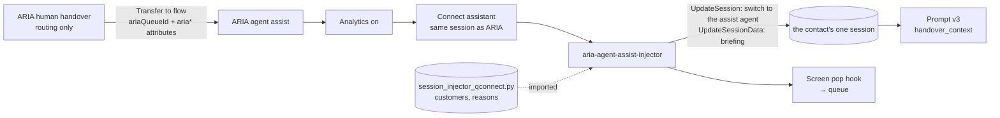

# Spec: ARIA Agent Assist

| | |
|---|---|
| Status | Built and unit-tested locally. **Not deployed.** All AWS changes are manual (see [README.md](README.md)) |
| Connect instance | `conversationbot` (`f969d4b4-f716-4974-a325-bb7899f2f293`, eu-west-2) |
| Assistant | `conversational-ai-domain` (`e6991ed4-e11c-4194-8d20-13889a36bd15`) |
| AI agent | `my-agent-assistant-agent` (`26ca6380-17fe-4828-bc53-537e1154ecbb`), version 3 today |

## 1. Problem

A human agent who receives a contact from ARIA has an AI assistant in the agent workspace, but it
starts with nothing: it does not know who the customer is, how they were verified, what ARIA did or
why the contact was handed over. It can suggest documents and write notes, and cannot look anything
up about the customer. On calls it depends on analytics having been switched on by the bot flow.

## 2. Goals and non-goals

**Goals**

- The assistant can suggest, without being asked: the first thing to do, related guidance, and a summary.
- It is briefed with the customer, their verification position, ARIA's summary and the known contact reasons.
- Agent assist lives in its own flow. `conversation bot flow` is not changed.
- A failure in agent assist never stops a customer reaching a person.

**Non-goals**

- Letting the assistant change anything. It gets read-only look-ups; the agent acts.
- A new screen pop. The existing `ARIA-Agent-Screen-Pop-Flow` is reused.
- Changing how contacts are routed. `aria-routing-lookup` still chooses the queue.

## 3. What exists today

Read from the instance on 13 October 2026.

| Piece | State |
|---|---|
| `ARIA human handover` | Routing Lambda → Connect assistant (agent v3) → set session → message → set queue → set four `aria*` attributes → screen pop hook → transfer to queue |
| `my-agent-assistant-agent` | Orchestration type, prompt `agent-assistance-promnpt` v2, tools `Retrieve` and `GenerateNotes`, locale `en_GB` |
| Prompt | No custom variables. Reads `{{$.transcript}}` and `{{$.conversationHistory}}` |
| Analytics | Real-time voice and chat analytics are set in `conversation bot flow` only |
| `Agent` security profile | Has `Wisdom.View` and `RealtimeContactLens.View` |

## 4. Design

### 4.1 A separate flow

| Considered | Outcome |
|---|---|
| Add the Lambda and analytics blocks to `ARIA human handover` | Rejected. Smallest change, but keeps routing and agent assist tangled, and no other route to a human could reuse it |
| A flow module invoked from the handover flow | Not chosen. A module returns to its caller, which is the ideal shape, but it was not confirmed that the Connect assistant block is allowed inside a module |
| **A separate flow that ends by queueing** | **Chosen.** The handover flow chooses the queue and transfers; the new flow does everything to do with the assistant |

The queue is chosen in one flow and used in the next. The handover flow passes it as the attribute
`ariaQueueId`, and the new flow sets the working queue from it. If the attribute is absent the
block's error branch carries on with the working queue already on the contact.

### 4.2 A separate Lambda

`aria-session-injector-qconnect` already writes customer context into an assistant session, and
could have been reused. A separate Lambda was chosen because the two have different readers and
different disclosure rules, and so the bot's injector is not touched.

| | ARIA's injector | Agent assist injector |
|---|---|---|
| Reader | Talks to the customer | Advises a member of staff |
| Known contact reasons | Only at the level the customer was verified to | All, with sensitive ones marked |
| Verification | Passed as a number | Passed as a plain instruction |
| ARIA's summary | Not applicable | Passed |

Customer data is imported from `session_injector_qconnect.py`, not copied. The deploy script zips
both files, the same way the ID&V harness does.

### 4.3 Failure behaviour

Every block before the queue sends its error branch onward. The Lambda never raises and its failure
branch also carries on. The only path to a disconnect is a failure to queue. A unit test asserts
that no pre-queue error leads to a disconnect.

## 5. Contracts

### 5.1 Lambda input

No block parameters. Read from contact attributes: `customerId`, `LoA` (or `loa`), `idvMethod`,
`ariaSummary`, `ariaCustomerIntent`, `ariaTopicCategory`, `ariaEscalationReason`, and as fallbacks
`conversationSummary`, `customerIntent`, `topicCategory`, `escalationReason`. Exact names only:
`HostedWidget-` prefixed attributes, which a browser can set, are ignored.

### 5.2 Session data written

`customerId`, `preferredName`, `productSummary`, `channel`, `verification`, `paymentApproved`,
`ariaCustomerIntent`, `ariaTopicCategory`, `ariaEscalationReason`, `ariaSummary`,
`knownContactReasons`, `vulnerabilityContext`. Each is truncated to 1,024 characters. Empty values
are not written. A unit test asserts the prompt binds exactly this set.

### 5.3 Lambda output

`status` (`injected`, `partial_failure`, or `error_*`) and `injectedKeys`. Both strings.

### 5.4 Manual change to `ARIA human handover`

Remove Connect assistant, Set contact data, Set event flow and Transfer to queue. Add `ariaQueueId`
(from `$.External.queueId`) to the existing Set contact attributes block. End with Transfer to flow
→ `ARIA agent assist`.

## 6. Security

- **Least privilege.** The role may call `connect:DescribeContact` on this instance and its contacts,
  and `UpdateSessionData` on this assistant and its sessions. The invoke permission is scoped to the
  instance ARN.
- **Read-only tools.** The assistant is given eight look-up tools. The tools that block cards,
  authenticate customers or raise payment approvals are not added.
- **Verification is stated, never upgraded.** A phone-number match is described as not verified
  whatever level accompanies it. A unit test asserts this.
- **Only flow-set attributes are read.** The Lambda ignores `HostedWidget-` prefixed attributes,
  which a chat customer's browser can set, so a customer cannot supply their own identity,
  verification level or handover summary. A unit test asserts this.
- **`paymentApproved` is a signal, not proof.** It is read from the opening words of ARIA's summary,
  which ARIA writes. A customer who manipulated ARIA into writing those words would produce a false
  signal. The prompt therefore has the agent read the payee and amount back to the customer before
  paying, and puts verification first: an approved payment never replaces an identity check. A server-side record of the approval, keyed by contact, would be the robust fix.
- **Staff-only data.** Vulnerability flags and all known contact reasons are passed to the assistant.
  The prompt tells it not to print the raw flags and to mark what must not be said to the customer.
  This relies on the prompt, and on the agent.
- **Session data is visible to the agent's assistant only**, not written to contact attributes.
- **Test data.** Customers, reasons and flags are the fictional stubs from the injector.

## 7. Verification status

| Check | Result |
|---|---|
| Unit tests (`python3 -m unittest discover -s connect-agent-assist/tests`) | 25 pass |
| Flow JSON structural validation | Pass, no placeholders |
| Prompt structure (indentation, variables match the Lambda) | Checked by script |
| Deploy script | Syntax check only. Not run |
| Lambda deployed, flow imported, prompt published | **Not done** |
| Live contact with an agent in the workspace | **Not done** |

## 8. Known gaps and open questions

**Known gap: a direct call always looks unverified to the assistant.** The verification level
reaches the handover as the contact attributes `LoA` and `idvMethod`. Only the ID&V harness sets
those. The main flow's Set contact attributes block copies sixteen values from its injector and
neither is among them, so on a direct call the assistant is told no identity check was recorded,
whatever the injector decided. That is the safe outcome. To change it, add `LoA` (from `$.External.loa`)
and `idvMethod` to that block in `conversation bot flow`; it is a manual change to the bot flow and
is deliberately not part of this work.

**Known gap: the mortgage topic does not route.** ARIA emits `topicCategory=mortgage`; the routing
table key is `mortgages`. The contact is disconnected in `ARIA human handover` before this flow
runs. This predates agent assist.

Only a live contact can answer these:

1. **When does the first suggestion appear?** The assistant responds to conversation turns. With only
   session data and no utterance yet, it may stay silent until the customer speaks to the agent.
2. **Does the assistant's `{{$.transcript}}` include the ARIA part of the conversation?** The design
   does not depend on it, because ARIA's summary is passed explicitly.
3. **Does a working queue set before a Transfer to flow survive it?** The design does not depend on
   it either, because of `ariaQueueId`.
4. **Is the Connect assistant block allowed in a flow module?** If so, a module would be a cleaner
   shape than a flow that ends in the queue.
