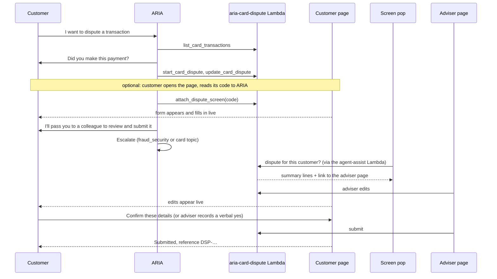

# Card Transaction Disputes and Adviser Access to Applications — Specification

| | |
|---|---|
| Status | Built, not deployed. **Part 4 (15 October 2026) is the current design for card disputes; Parts 1 and 3 are earlier designs kept in the code.** Part 1 (card disputes) is in this folder. Part 2 (mortgage application) is in Live Sync PR #9 and `connect-agent-assist/`; section 12 says what is and is not done |
| Date | 13 October 2026 |
| Depends on | `connect-agent-assist/` (PR #31): the agent-assist flow, its Lambda and the screen pop |
| Related repo | `connect-livesync-mortgage` (the mortgage application journey) |

## 0. Three findings that shape this design

These came from reading the Live Sync repository and the live Connect instance. They correct what
was assumed before this work started.

1. **Live Sync does not store the mortgage application.** The customer's answers live in their
   browser tab (`sessionStorage`) and nowhere else. The Live Sync table holds only short-lived
   codes and tokens, and submitting returns a reference without saving anything. There is nothing
   for an adviser or an assistant to look up until the form is saved on the server. That is a
   change to Live Sync's frozen requirements (Part 2).
2. **Live Sync cannot be driven by a human.** AWS provides it for an AI agent filling a page. Once a
   human adviser takes the contact, nothing drives the customer's page. So "the customer watches the
   adviser go through the form" cannot be done with Live Sync. It needs a record on the server that
   the adviser's screen writes and the customer's screen reads.
3. **ARIA cannot use Live Sync.** Live Sync belongs to a different kind of AI agent (built in the
   agentic CX designer). ARIA is a Connect AI agent and can only act through tools. In the mortgage
   journey ARIA fills nothing: it hands the contact to that other agent.

**Consequence.** Card disputes are built on one shared record: ARIA writes it with tools, the
adviser's page writes it, and the customer's page shows it. To the customer it looks like the
mortgage journey (the form fills in as they talk), but it works differently underneath.

---

# Part 1 — Card transaction disputes

## 1. Goal

A customer tells ARIA they want to dispute a card transaction (debit or credit). ARIA fills in as
much of the dispute as it can and hands the contact to an adviser. The adviser reviews the form,
completes it, confirms the details with the customer and submits it. The customer can watch the
form on their own screen while ARIA and then the adviser fill it in.

## 2. Out of scope

- Sending the dispute to a card scheme or a real case system. Submitting marks the record
  `submitted` and gives a reference. A real integration replaces one function.
- Uploading evidence (receipts, emails).
- Refunds, provisional credits and any movement of money.
- A customer starting or editing a dispute on the web page without a contact. The page is a view
  with one button.
- Notifications (email, SMS) about the dispute.

## 3. Two kinds of dispute

The first question decides the route, so ARIA asks it before anything else:
**"Did you make or authorise this payment yourself?"**

| | Unauthorised | Problem with a payment the customer made |
|---|---|---|
| Customer's answer | "No" or "I don't recognise it" | "Yes, but…" |
| `disputeType` | `unauthorised` | `merchant` |
| Reasons | `card_lost_or_stolen`, `card_details_used_without_card`, `not_recognised` | `goods_not_received`, `not_as_described`, `charged_twice`, `wrong_amount`, `cancelled_subscription`, `refund_not_received` |
| Extra questions | Do you still have the card? | Have you contacted the retailer? |
| ARIA also offers | To block the card now (existing block tools) | Nothing |
| Routed as | `fraud_security` → Fraud Team | The card's own topic: `debit_card` or `credit_card` → Cards Team |

The request named the fraud adviser for all disputes. A payment the customer made is not fraud, so
it goes to the Cards Team by default. `MERCHANT_DISPUTE_TOPIC=fraud_security` on the Lambda sends
everything to the Fraud Team instead.

## 4. The record

One item per dispute in the DynamoDB table `aria-card-disputes`.

| Field | Values | Set by |
|---|---|---|
| `disputeId` | `DSP-` + 8 characters | System |
| `customerId` | From the session, never from the customer's words | System |
| `status` | `draft` → `with_adviser` → `submitted` (or `withdrawn`) | System |
| `version` | Counts every change | System |
| `cardType`, `cardLastFour` | `debit` / `credit`, 4 digits | From the chosen transaction |
| `transactionId`, `transactionDate`, `merchant`, `amount`, `currency` | | From the chosen transaction |
| `disputeType` | `unauthorised` / `merchant` | ARIA or adviser |
| `reason` | One of the reasons for the type (section 3) | ARIA or adviser |
| `cardInPossession` | `yes` / `no` (unauthorised only) | ARIA or adviser |
| `cardBlocked` | `yes` / `no` | ARIA or adviser |
| `contactedMerchant` | `yes` / `no` (merchant only) | ARIA or adviser |
| `narrative` | The customer's own account, up to 600 characters | ARIA or adviser |
| `filledBy` | For each field: `aria` or `adviser` | System |
| `customerConfirmation` | `accepted`, `source` (`customer_click` or `adviser_recorded`), time | Customer page or adviser page |
| `history` | Time, who, action, field names. Never values | System |

**Complete** means: transaction, `disputeType`, `reason`, `narrative`, and `cardInPossession`
(unauthorised) or `contactedMerchant` (merchant).

**Rules the Lambda enforces, whoever asks:**

- R1. ARIA's tools can change a dispute only while it is `draft`.
- R2. ARIA's tools can never set `customerConfirmation` and can never submit.
- R3. A dispute can be submitted only when it is complete and `customerConfirmation.accepted` is true.
- R4. A dispute belongs to one customer. Every tool call must carry the same `customerId` the
  dispute was created with.
- R5. The transaction's details are copied from the bank's record of that transaction, never from
  what a caller passes in.
- R6. Changing the transaction, type or reason after the customer confirmed clears the confirmation.

## 5. Who does what

### 5.1 ARIA's tools

Published on the existing MCP gateway as a new target, `aria-banking-dispute`.

| Tool | Does | Returns |
|---|---|---|
| `list_card_transactions` | Recent card transactions for the customer, optionally one card type | Transactions with a stable `transaction_id` |
| `start_card_dispute` | Creates a draft for one transaction and type. If the customer already has an open draft for that transaction, returns it | `dispute_id`, the record, `missing` |
| `update_card_dispute` | Sets any of: `dispute_type`, `reason`, `card_in_possession`, `card_blocked`, `contacted_merchant`, `narrative` | The record, `missing` |
| `get_card_dispute` | Reads a dispute by id, or the customer's latest open one | The record, `missing`, `status` |
| `attach_dispute_screen` | Shows the dispute on the customer page whose 6-digit code the customer read out | `attached` |

`get_card_dispute` is also given to the agent-assist agents. It only reads.

### 5.2 The customer page

A public web page that shows nothing until a contact attaches a dispute to it.

1. The customer opens the page. It shows a 6-digit code: "Read this code to the assistant."
2. The customer reads the code to ARIA (or types it in chat). ARIA calls `attach_dispute_screen`.
3. Within two seconds the page shows the dispute, and keeps it up to date every two seconds: each
   field, who filled it in, and a highlight when it changes.
4. When the dispute is with the adviser and complete, a button appears: **"These details are
   correct."** Pressing it records the customer's confirmation.
5. After the adviser submits, the page shows the reference.

**Why the code goes from the page to the call, not the other way.** A code read out by ARIA and
typed into a public page would show a customer's dispute to anyone who guessed or overheard a code.
Here the page holds a long secret it never shows, and the code only works when a verified caller
reads it out on their own contact. This is the pattern Live Sync uses for its help code.

The page is optional. A customer who is not near a screen gets the same service without it.

### 5.3 The adviser

- **Screen pop.** When a contact arrives and the customer has an open dispute, the screen pop shows
  a "Card dispute" section: reference, type, transaction, what is still missing, whether the
  customer is watching, and a link, **Open dispute form**.
- **Adviser page.** The link opens the dispute form. The adviser can change every field in
  section 4, see whether the customer has confirmed, tick "Customer confirmed these details to me"
  when the customer is not using the page, and press **Submit**. Submit is refused until R3 holds.
- **Assistant.** The arrival briefing and the Connect assistant panel can read the dispute with
  `get_card_dispute` and tell the adviser what is missing.

The link carries a token that is made for that contact, lasts 60 minutes, and is kept in the part
of the address that browsers do not send to servers. Opening the adviser page moves the dispute
from `draft` to `with_adviser`.

## 6. Components

| Component | Where | Notes |
|---|---|---|
| `aria-card-dispute` Lambda | `lambda/` | One function, three ways in (below) |
| DynamoDB table `aria-card-disputes` | Created by the deploy script | One table: disputes, page sessions, codes, adviser tokens. Time-to-live on the short-lived items |
| HTTP API | Created by the deploy script | Serves the two pages and their JSON calls |
| Gateway target `aria-banking-dispute` | Added by the deploy script | The five tools |
| Customer page, adviser page | `web/` | Plain HTML, CSS and JavaScript, served by the Lambda. No inline script |
| ARIA prompt block | `prompts/` + `scripts/build_aria_prompt.py` | Inserted into the live prompt by a script, so it is always based on the current version |
| Screen pop | `connect-agent-assist/flows/` | Gains a "Card dispute" view |
| Agent-assist Lambda | `connect-agent-assist/lambda/` | `get_briefing` also asks the dispute Lambda about this customer |

**Three ways into the Lambda, told apart by the shape of the request:**

| Way in | Caller | May do |
|---|---|---|
| Web | Anyone, through the HTTP API | Page files; customer calls (with the page's secret); adviser calls (with an adviser token) |
| Tool | The MCP gateway's role | The five tools |
| Internal | The agent-assist Lambda's role | `screen_pop`: summary lines and a new adviser link |

The way in is decided by how a request arrived, never by what it asks for:

- A web request can never be treated as a tool or internal call. The HTTP API always adds its own
  envelope, and the Lambda checks for it first.
- A request from the MCP gateway is always a tool call, even if its arguments ask for `screen_pop`.
  That matters because `screen_pop` hands out an adviser link, which can confirm and submit. If
  ARIA could reach it by passing an argument, rule R2 would be a suggestion, not a rule.

## 7. Security

| Risk | Control |
|---|---|
| Someone opens the customer page and sees another person's dispute | The page shows nothing until a verified contact attaches a dispute by code. Codes are 6 digits, single use, 10 minutes. Five wrong codes on one dispute lock attaching for that dispute |
| A code is overheard | A code alone opens nothing. It only tells the Lambda which waiting page a verified caller means |
| The adviser link leaks | It lasts 60 minutes, is tied to one dispute, is never sent to a server by the browser, and is stored only as a hash. The screen-pop flow has its logging switched off, because a flow's log records the view it shows |
| ARIA submits or confirms for the customer | R1 and R2 are enforced in the Lambda, not in the prompt |
| A caller disputes someone else's transaction | R4 and R5: the customer id comes from the session, and the transaction must be in that customer's own list |
| Personal data in logs | Logs carry the operation, the outcome and the dispute id only. Never the narrative, merchant, amount, codes or tokens |
| The pages run injected script | No inline script; a content security policy allowing only the page's own files; all text written with `textContent` |
| Verification level | ARIA starts a dispute only for an authenticated customer at Level 2 or above, the same bar as account information. The adviser is told the level in the screen pop, as today |

## 8. Known gaps

- **Not tested live.** Everything here is unit-tested only until the first test contact.
- **A direct call arrives at Level 3 on the phone number alone** when `CLI_MATCH_LOA=3`. A dispute
  started on such a call is drafted on a spoofable identity. The adviser's own verification before
  submitting is the control. The screen pop says so.
- **The screen-pop flow no longer logs.** A flow's log records the whole view it shows, which
  would include the adviser link and, for a mortgage application, date of birth and income. The
  cost is that a screen-pop fault can no longer be read from the flow log; the Lambda's own log
  still shows each request.
- **Any adviser with the link can open the form.** It is not tied to the adviser's login.
- **Whether the screen pop's link opens the page** depends on the Detail view accepting a link
  whose address is filled in at run time. If it does not, the address is also shown as text.
- **The transactions are test data** held in the Lambda, not the account tool's list.
- **Default table encryption.** The table uses AWS-owned keys. Use a customer-managed key in
  production.
- **Polling every two seconds.** Fine for a demo. A WebSocket would replace it at scale.

## 9. Acceptance

1. ARIA drafts an unauthorised dispute end to end; the contact reaches the Fraud Team; the screen
   pop shows the dispute and the link.
2. ARIA drafts a merchant dispute; the contact reaches the Cards Team.
3. With the customer page open and attached, a field ARIA sets appears on the page within about
   two seconds, and so does a field the adviser changes.
4. Submit is refused before the customer confirms, and accepted after either kind of confirmation.
5. ARIA's tools cannot change a dispute once the adviser has opened it, and can never submit.
6. A wrong code attaches nothing; five wrong codes lock attaching for that dispute.

---

# Part 2 — Adviser access to a mortgage application

## 10. What is wanted

A mortgage adviser can see a customer's application, in progress or submitted, and its status. When
the customer asks, the assistant can bring it forward.

## 11. What has to change, and where

| # | Change | Repo | State |
|---|---|---|---|
| M1 | Save the application on the server as the customer fills it in | Live Sync | Built: [connect-livesync-mortgage PR #9](https://github.com/alokkulkarni/connect-livesync-mortgage/pull/9). Not merged or deployed |
| M2 | Read an application by its id | Live Sync | Built in the same PR (`getApplication`, no internet route) |
| M4 | The adviser sees the form | this repo | Built: the screen pop's "Mortgage application" view lists the saved form, read-only |
| M3 | A `get_mortgage_application` tool for the assistant | this repo | Not built. The assistant cannot yet report on an application |

**M1 in detail.** A new page operation, `saveApplication`, called a moment after each change. It
stores stage, field values, uploaded document types, the Decision in Principle result, the chosen
product, and whether it was submitted. This changes two things Live Sync's design states today:
items would live for days, not minutes (decision D5), and date of birth and income would be stored
at rest (the table is already encrypted with a customer-managed key). Both need a new requirement
in `docs/REQUIREMENTS.md` before any code, under that repo's rules.

**Finding a customer's application.** The web journey gives each browser tab a random application
id and knows no customer id. An application can be found by customer only when the contact carried
one in: a call transferred by ARIA does, a customer who started on the website does not. Until the
bank's login supplies the customer id to the page, the adviser can open an application only on a
contact that carries its `applicationId`.

**Adviser changes to the customer's form are not in scope.** Finding 2: nothing can push an
adviser's edit into the customer's Live Sync page. M4 is read-only.

## 12. What was built, and what it needs

**In Live Sync (PR #9).** Requirements v1.22 add FR-38 (save), FR-39 (read) and NFR-21 (30 days,
never logged). The page saves a moment after each change. Reading is by direct Lambda invocation
only. Because the reference page has no sign-in, the first save returns a key that later saves must
present, so nobody can overwrite an application by guessing its id.

**Here.** `aria-agent-assist-injector` reads the application a contact carries (the contact
attribute `applicationId`) and returns six lines, which the screen pop's "Mortgage application" view
shows under **Application form**: status, About you, Property and loan, Decision and product,
Documents, and what is still to fill in. It shows a submitted application the same way, with its
reference.

**To switch it on:** merge and deploy Live Sync PR #9 (its backend and web scripts), then run
`connect-agent-assist/scripts/deploy_agent_assist.sh` and re-import the screen pop.

**Limits.**

- Only a contact that carries `applicationId` shows a form. A customer who rings the main number
  about an application does not carry one, and there is no find-by-customer (section 11).
- **The form is chosen by the application ID the contact carries, not by who the customer is.** On
  the web journey that ID comes from the customer's browser, and a saved application records no
  customer. Someone who started a contact with another application's ID would cause the adviser to
  be shown that application. The ID is 8 random characters and contact starts are rate-limited,
  but this is not identity. So the screen pop says the form was found by ID and to confirm
  identity first, and it never shows the date of birth. Closing the gap properly needs the bank's
  login to put a customer on the application.
- The view is read-only, and nothing the adviser does changes the customer's page (finding 2).
- The assistant panel cannot yet answer questions about the application (M3).
- "Bring it forward" is the screen pop showing it. Nothing opens the customer's page for the adviser.

---

# Part 3 — A disputes agent, and a Live Sync dispute page

Part 1 has ARIA do everything itself. Part 3 moves the dispute conversation out of ARIA, two ways.
Both keep Part 1's record, rules and adviser page unchanged.

## 13. Why

ARIA's prompt is at 81,000 of 100,000 characters, at its limit of 19 custom variables, and carries
23 tools. Every journey added to it slows every turn and leaves less room for the next.

## 14. Two routes, and which one ARIA takes

| | Route 1: disputes agent | Route 3: Live Sync page |
|---|---|---|
| What it is | A second Connect AI agent, added to ARIA as a collaborator | A CX designer agent that drives a dispute form on the customer's screen |
| Mechanism | Agent-to-agent hand-off (A2A), run by Connect | Return-to-Control tool, then the Agentic CX flow block |
| Who talks to the customer | The disputes agent, as ARIA | The CX designer agent |
| The customer's screen | Optional, read-only, as in Part 1 | Required. The form fills in as they speak, and they can type in it |
| Tools | The five tools from Part 1 | One Data request, `attachToScreen`. The page saves the form |
| ARIA resumes afterwards | Yes, and transfers to the adviser | No. The Agentic CX block's Escalation branch transfers |

**D1. Who does what on a dispute call (decided 15 October 2026).**

- **ARIA does the initial checks and hands over.** It confirms the customer is authenticated at
  Level 2 or above (stepping up first if not), deals with any vulnerability as it always does, and
  asks nothing about the payment, the page or a code.
- **The disputes agent handles the dispute end to end**, from the context ARIA passes: which
  payment, whether the customer made it, every field, blocking the card, offering the screen and
  attaching it, reading it back.
- **It hands back to ARIA**, which escalates to an adviser for the final check and submission.
- **ARIA keeps the context.** Connect merges the disputes agent's conversation into ARIA's session
  when it hands back. ARIA never asks again for anything already said. If the customer turns to
  something else and later returns to the dispute, ARIA hands over again with the dispute's
  reference, and the disputes agent carries on with that dispute rather than starting another.

**Consequence for route 3.** A dispute call no longer reaches the Live Sync page, because only ARIA
could start it (with its Return-to-Control tool) and ARIA no longer asks about the page. On a call,
the customer still sees the form fill in live: the disputes agent attaches their page as a view
(Part 1). Route 3 stays built, for an entry that starts from the web page itself, which is not yet
wired up.

**D2. One voice, no joins showing.** The customer must not hear a hand-off in either direction on
route 1:

- The disputes agent speaks as ARIA. It never introduces itself, greets again, or says the customer
  has been passed to anyone.
- ARIA hands off without announcing it, and when the conversation comes back it does not greet or
  recap. Its next words are the transfer line.
- A collaborator in the same instance has no voice of its own. Its text goes out through the same
  Lex bot and the same text-to-speech as ARIA's, so the voice is the same by construction. What
  could still show a join is the wording on the hand-off turn, which the two prompts control, and
  a pause while the second agent starts, which is the first thing to time on a live call.
- The disputes agent hands back by calling Escalate with every field ARIA's own Escalate needs
  (topic, reason, intent, summary). A reserved tool call with a field missing fails.

Route 3 is a different agent with its own turn-taking, so a join there is expected. Its opening line
acknowledges what ARIA was told.

**D3. What passes between ARIA and the disputes agent.**

- *Into the hand-off.* Whether a collaborator receives ARIA's session values is not documented. So
  the disputes agent's prompt reads them itself, and ARIA is also told to state the customer ID,
  the verification level and what the customer said. The first live call shows which arrived.
- *Back to ARIA.* The disputes agent ends with its Escalate tool and a reason in a fixed form that
  ARIA copies into its own Escalate call:
  `Card dispute DSP-XXXXXXXX drafted. topicCategory=<topic>. <retailer>, <amount>, <kind>. Missing: <list or none>.`
  The topic comes from the `handover` field the dispute tools already return.
- If the disputes agent cannot draft a dispute, the reason begins `Card dispute not drafted.` and
  ARIA transfers with what it has.

**D4. Where the level of assurance is checked.**

- *Route 3: in the Lambda.* `attachToScreen` already reads the contact's own attributes from
  Connect, so it also requires `authStatus` to be `authenticated` and, where an ID&V flow set a
  level, Level 2 or above. An unverified caller's page is never attached, whatever the agent is
  persuaded to try.
- *Routes 1 and Part 1: in the prompts.* A tool call carries no contact, so the Lambda cannot tell
  how that customer was verified. ARIA hands off only at Level 2 or above, and the disputes agent
  refuses below it.
- A caller recognised by phone number alone counts as authenticated when ARIA's injector is set to
  treat them so (`CLI_MATCH_LOA`). That is this instance's choice, and it applies to every route.

## 15. Route 3 changes the page from a view into a form

In Part 1 a page attaches to a dispute that already exists. For Live Sync to fill a form there must
be a form before there is a dispute, as in the mortgage journey. So:

1. The page shows its code, as now.
2. `attachToScreen` attaches the **contact** to the page, with no dispute yet. The Lambda finds the
   customer from that contact's own attributes; it never takes a customer ID from the agent.
3. The page now shows an empty form and the customer's recent card transactions to choose from,
   and starts Live Sync bound to that contact.
4. The CX designer agent fills the fields as the customer speaks. The customer can type too.
5. The page saves the form to the Lambda a moment after each change, using its own secret. The
   first save that names a transaction creates the dispute.
6. On escalation the adviser gets the screen pop and the adviser page exactly as in Part 1, and the
   customer's page follows the adviser's changes.

**New rules.**

- R7. `attachToScreen` takes a contact ID and a code. The customer is whoever that contact's
  `customerId` attribute says, read by the Lambda from Connect.
- R8. A page may save only while its session is attached to a contact, and only a dispute that is
  a draft. Once an adviser has it, the page is read-only again.
- R9. A page save can set the transaction (one of that customer's own) and the Part 1 fields. It
  can never confirm or submit. Confirmation is still the customer's own button, after the adviser
  has the dispute.
- R11 (added 19 Oct 2026). The customer may submit their own dispute themselves, from the form
  (`/api/screen/submit`) or the banking app's list: only theirs, only while it is a draft, and only
  when nothing is missing. Submitting records their confirmation (`customer_submitted_form` or
  `_app`) and `submittedBy: customer`. A dispute an adviser has stays with the adviser (R3).
  On a call from the banking app (`appPage` on the contact), `sendFormLink` opens the form in the
  app instead of texting it.
- R10. Fields set through the page are recorded as filled by `page`. The page cannot tell the
  agent's typing from the customer's, and does not claim to.

**A fourth way into the Lambda.** CX designer tools call an HTTPS address with a key, not the MCP
gateway. `POST /acxd/ops` on the same HTTP API accepts `attachToScreen` only, and only with the key
held in Secrets Manager. It is a web request, so it can never reach the internal screen-pop
operation or a tool.

**Live Sync actions.** None beyond Touchpoint's own form fill. There is one page, so there is no
navigation, and there is no action that confirms or submits.

## 16. What is built and what you configure

| Piece | Built here | You do |
|---|---|---|
| Disputes agent prompt | `prompts/disputes-agent-prompt-v1.yaml` | Create the prompt and agent in the console |
| ARIA's shorter dispute section | `prompts/card-disputes-collaborator-block.txt`, `build_aria_prompt.py --mode collaborator` | Paste and publish |
| Attaching the collaborator | `scripts/attach_disputes_collaborator.sh` | Run it. There is no console screen for this |
| Lambda: attach a contact, page save, CX designer door | `lambda/` | Run the deploy script |
| The form page with Live Sync | `web/` | Nothing |
| CX designer configuration | `acxd/` | Build the application in the designer from it |
| Hand-over tool for ARIA | `acxd/connect-ai-agent/StartCardDispute.schema.json` | Create the tool in the console |
| Hand-over flow | `flows/` | Import it, and add one branch to the bot flow |

## 17. Known gaps (Part 3)

- **Nothing here has run on a live contact**, including the A2A hand-off itself.
- **"Connect Customer" tier.** Agent-to-agent collaboration needs it. The attach script will fail
  if the instance is not on it; that is how you find out.
- **Card blocking on route 3.** The CX designer agent has no tool to block a card. It tells the
  customer the adviser will do it.
- **Route 3 on chat** is not built. Live Sync here binds to a phone call by code.
- **The Touchpoint library is served by the Lambda** (3.6 MB). Fine for a demo; use a CDN in
  production.
- **Live Sync on this page is copied from the mortgage page's working pattern**, but that pattern
  took many live fixes there. Expect the same here.

---

# Part 4 — The CX designer disputes assistant does the dispute end to end

Decided 15 October 2026. It replaces D1 and route 1 of Part 3 for dispute calls.

## 18. What is wanted

> ARIA, on a dispute or a payment the customer does not recognise, calls the disputes agent in the
> CX designer, which handles everything end to end, including Live Sync: it completes the form on
> the customer's behalf, asking what it needs and prefilling everything else, and if the customer
> wants to see the form it sends them the link. Then it hands over to ARIA to be transferred to a
> human agent for final verification before the form is submitted, with the entire summary (cards
> blocked, cards ordered, the form) in the screen pop. Agent assist gets the tools already
> described. Ignore the AI agent created in Connect for disputes.

## 19. Decisions

**D5. ARIA checks and starts; the CX designer assistant does everything else.** ARIA confirms the
caller is verified at Level 2 or above and handles any vulnerability, then calls the
Return-to-Control tool `StartCardDispute` with one sentence of what the customer already said. It
asks nothing about the payment, the card, a form or a code. The bot flow transfers to the flow
`Card dispute assistant`, whose Agentic CX block runs the CX designer application `Card dispute`.

**D6. "Hands back to ARIA" is ARIA's own hand-over path.** ARIA's Escalate tool only sets four
attributes, and the bot flow then runs `ARIA human handover`. The disputes flow ends on the same
flow with the same four attributes. Re-entering ARIA's Lex block would add a turn of silence,
because the bot waits for the caller to speak first, and ARIA would have nothing to add.

**D7. The hand-over is built from the record.** After the Agentic CX block, the flow calls
`aria-card-dispute` with `operation=handover`. The Lambda builds the team (`fraud_security` for a
payment the customer did not make, otherwise the card's team or `MERCHANT_DISPUTE_TOPIC`), the
summary and the dispute reference from what was saved, not from what the assistant remembers. The
summary starts "Card dispute …" so the briefing agent reads the dispute. The assistant adds only a
one-sentence note and a reason, stripped of formatting before it reaches the screen pop. If the
Lambda fails, the call still goes to `fraud_security` with a fixed summary.

**D8. Seven Data requests, identity from Connect.** `listCardsAndPayments`, `startDispute`,
`updateDispute`, `getDispute`, `blockCard`, `orderReplacementCard`, `sendFormLink`, all on
`POST /acxd/ops` with the key. None takes a customer ID or phone number: the Lambda reads the
contact's attributes (`customerId`, `authStatus`, `LoA`, `customerPhone`) from Connect and applies
the verification gate (rule R7) on every call. A refusal is HTTP 200 with `ok:false`, a reason
and a message, so the assistant can read it and carry on. Every reply always has every field.

**D9. Card actions.** Block and replacement work only on the customer's own cards, are idempotent
(a repeated call returns the first reference), and a replacement needs the card blocked. They are
kept on the customer, not the contact, because the screen pop runs under a different contact. A
block sets "card blocked: yes" on an open draft for that card. The cards are test data; a real
deployment calls the card system in `DisputeService.card_action`.

**D10. The form link, on phone and chat.** The flow records the channel (`disputeChannel` =
`$.Channel`) before the assistant starts, and passes it to the assistant as `channel`. On a call,
`sendFormLink` texts the number the customer is calling from (UK mobiles only by default) through
AWS End User Messaging. On chat, it returns the link for the assistant to post in the chat: the
customer is already in that verified conversation, and a chat has no number to text. The chat
transcript then holds a link that works for two hours and five opens. The link carries its secret after `#`, so
it never reaches a server log. Opening it gives a page session already joined to the call and the
dispute, so Live Sync starts with no code. It works for two hours and five opens, and can be sent
three times per dispute. On a call the assistant never sees the link. Without an SMS sender configured, the
assistant is told it cannot text and carries on by voice.

**D11. The assistant saves; the page shows.** The assistant writes every answer with
`updateDispute`. The page shows the saved record within two seconds and saves what the customer
types, so both always agree. Live Sync lets the assistant see the page; it does not need to fill
the page itself.

**D12. Same voice.** ARIA's last words are one neutral sentence; the assistant never introduces
itself, and its opening, built before the assistant node, asks about the payment. The CX designer
application's voice must be set to ARIA's (Amy, en-GB); Connect's Set voice block does not change it.

**D13. Fraud, scam or dispute (decided 16 October 2026).** Every case is a dispute on the record,
with one of three types: `unauthorised` (FRAUD: the customer did not make it), `scam` (SCAM: they
made it but were tricked) or `merchant` (DISPUTE: they made it and something went wrong). The
assistant decides which from what the customer says, tells them, and:
- for FRAUD and SCAM, blocks the card and orders a replacement first (with the customer's yes),
  then raises the case; both go to `fraud_security`;
- for a DISPUTE, does not touch the card; it goes to the card's team.
The case is shown as the first word of the screen pop, in the hand-over summary ("Case: FRAUD."),
in a case-specific escalation reason (`fraud_ready_for_review`, `scam_incomplete`, …) and intent.
The customer is told what happens next from `WHAT_HAPPENS_NEXT` in `dispute_model.py`, word for
word, so no timescale is invented. **That wording is a placeholder for the bank's approved text.**

## 20. New rules

| # | Rule | Enforced in |
|---|---|---|
| R11 | The CX designer door acts only for a verified caller, found from Connect's record of the contact | `dispute_web._acxd`, `aria_card_dispute.verified_customer` |
| R12 | A card can be blocked or replaced only if it is the customer's own; each at most once | `DisputeService.card_action` |
| R13 | A form link goes only to the number the customer is calling from, or into the chat they are in; at most three times per dispute | `dispute_web._send_form_link`, `DisputeService.mint_form_link` |
| R14 | A Connect flow event is accepted only when it is not a tool call; its reply holds no link or secret | `aria_card_dispute.lambda_handler` |
| R15 (added 20 Oct 2026) | A customer who has finished with the dispute (submitted, saved for later, or not going on) and wants anything else goes back to ARIA, not to a colleague: the assistant's `BackToARIA` flow escalates with `escalationReason` `back_to_aria` and a one-line `summary` of what they want now; the flow sets `entry=returned`, `returnedFrom`, `returnSummary` and transfers to ARIA's bot flow. Asking for a person still goes to a colleague | `flows/build_card_dispute_flow.py` (`CheckBackToAria`), the assistant's prompt ("When to go Back to ARIA") |

## 21. Known gaps (Part 4)

- **The "what happens next" timescales are placeholders** (15 working days for fraud and scam, 8
  weeks for disputes). Replace them in `dispute_model.WHAT_HAPPENS_NEXT` with approved wording.
- **Fraud, scam or dispute is the assistant's judgement** from the conversation. The adviser sees the
  case type and can change it on the form before submitting.

- **Nothing here has run on a live contact.** The CX designer steps follow the mortgage build, which
  works, but this application is new.
- **The opening question** is generated from ARIA's one-sentence summary. If ARIA's summary is
  thin, the first question is generic.
- **SMS** needs an End User Messaging sender and, until production access, verified destination
  numbers. UK sender rules are to be checked in the console.
- **Chat links sit in the transcript** for their two hours. Anyone who can read the transcript in
  that time could open the form (view and type, never confirm or submit).
- **Contact attributes are cached for 30 seconds** in the Lambda, so a verification made during the
  dispute is seen up to 30 seconds late.
- **The adviser's own tools** (blocking, refunds) are outside this work; the screen pop says what the
  assistant did.

