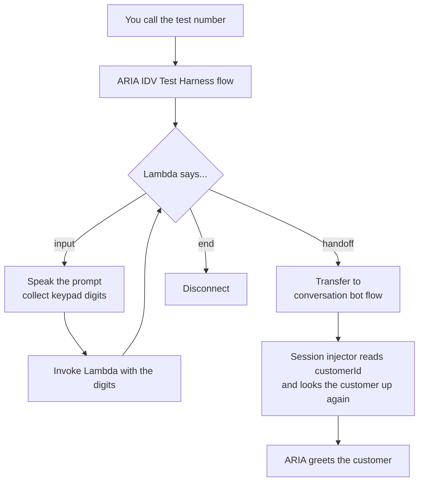

# ARIA ID&V Test Harness — Complete Novice Guide

A **test-only** contact flow for Amazon Connect that lets you:

1. **Be any test customer**, whatever phone you call from, and land in the main ARIA flow as them.
2. **Practise identification and verification (ID&V)** the way the design document
   *CLI identification and caller verification on Amazon Connect* describes it: every option, A to F.

> **Nothing in this folder has been deployed.** The code is unit-tested on a laptop only. You create
> the Lambda and the flow in AWS yourself by following Parts B to E. The technical design is in
> [SPEC.md](SPEC.md).

---

## Table of Contents

- [1. Concepts You Must Understand First](#1-concepts-you-must-understand-first)
- [2. What You Are Building](#2-what-you-are-building)
- [3. What Is in This Folder](#3-what-is-in-this-folder)
- [4. Prerequisites](#4-prerequisites)
- [Part A — Run the Tests on Your Laptop](#part-a--run-the-tests-on-your-laptop)
- [Part B — Deploy the Harness Lambda](#part-b--deploy-the-harness-lambda)
- [Part C — Allow Connect to Use the Lambda](#part-c--allow-connect-to-use-the-lambda)
- [Part D — Create the Test Flow](#part-d--create-the-test-flow)
- [Part E — Point a Test Phone Number at the Flow](#part-e--point-a-test-phone-number-at-the-flow)
- [Part F — (Recommended) Redeploy the Session Injector](#part-f--recommended-redeploy-the-session-injector)
- [Part G — Your First Call](#part-g--your-first-call)
- [Part H — Test Every Option (A to F)](#part-h--test-every-option-a-to-f)
- [Part I — Test Chat (Option E)](#part-i--test-chat-option-e)
- [Reference: Test Customers](#reference-test-customers)
- [Reference: Contact Attributes](#reference-contact-attributes)
- [Reference: Reason Codes](#reference-reason-codes)
- [Understanding Every Block You Used](#understanding-every-block-you-used)
- [Troubleshooting](#troubleshooting)
- [Switching It Off and Removing It](#switching-it-off-and-removing-it)

---

## 1. Concepts You Must Understand First

### What is CLI?

**CLI** means *Calling Line Identification*: the phone number a call arrives from. Amazon Connect
gives it to your flow as the **customer endpoint address**.

The design document's central idea is this sentence:

> CLI is a claim about a line, not proof about a person.

A phone number tells you which *line* is calling. It does not tell you who is *holding the phone*.
It could be the customer, their partner, a friend whose phone they borrowed, or a fraudster who has
moved the number to a new SIM card.

### Identify, verify, authorise

The document splits "who is this?" into three separate questions. The harness keeps them separate too.

| Question | Plain English | In the harness |
|---|---|---|
| **Identify** | Who do we *think* this is? | Look the phone number up, or ask for date of birth and card digits. The answer is a **candidate**, a guess. |
| **Verify** | Prove it. | Send a challenge to something registered to that candidate (their app, mobile or email). |
| **Authorise** | What may they do? | A fixed set of rules compares what they want with how sure we are. |

### What is a level of assurance (LoA)?

**LoA** is a number from 0 to 3 that says how sure the bank is about who is on the line.

| Level | Name | How you get there | What it allows |
|---|---|---|---|
| 0 | Anonymous | Nothing known | General information |
| 1 | Identified | We have a candidate, but no proof | Protective actions, such as freezing a card |
| 2 | Verified | One proof: a one-time code, or a security question | Balances |
| 3 | Strongly verified | Approval in the bank app, or two proofs on your own phone | Changing an address, paying a new payee |

What the caller *wants* decides the level they *need*. Asking for opening hours needs nothing.
Changing an address needs level 3.

### What is a receipt?

When a verification succeeds, the verifier produces a **signed receipt**: a short tamper-proof note
saying "customer X passed check Y on this contact". The rules engine only raises the level when it
is handed a valid receipt. The part of the code that talks to the caller **cannot** raise the level
itself. This is the document's main safety rule for AI agents: *the agent can never grant assurance
itself*.

### What is the session injector?

`aria-session-injector-qconnect` is the Lambda in your main flow that tells ARIA who the customer
is. It reads a contact attribute called `customerId`. **Only if that attribute is empty** does it
fall back to looking up the caller's phone number.

That one fact is how this harness works:

> The harness sets `customerId` as a contact attribute, then transfers the call to the main flow.
> Contact attributes travel with the call. The injector sees `customerId`, looks that customer up in
> its own list, and builds ARIA's context for them. Your real phone number is never consulted.

### What is a contact attribute?

A named value attached to one call or chat, for example `customerId = CUST-003`. Flows, Lambdas and
the contact record can all read it. Attributes stay with the contact when it moves to another flow.

---

## 2. What You Are Building



The flow is a **loop**. It contains no ID&V logic at all. Each time round, it asks the Lambda
"what next?", and the Lambda answers with one of three instructions:

| The Lambda returns `action` = | The flow does |
|---|---|
| `input` | Speaks the Lambda's `prompt`, waits for you to key digits, sends the digits back to the Lambda |
| `handoff` | Speaks the `prompt`, transfers you to the main `conversation bot flow` |
| `end` | Speaks the `prompt`, hangs up |

All the questions, the rules and the test customers live in the Lambda. This keeps the flow small
enough to build by hand (13 blocks) and lets the logic be tested on a laptop.

### Two kinds of sentence you will hear

- Sentences a **real agent would say**, taken from the design document:
  *"Is this call about the account linked to the number you're calling from?"*
- Sentences that begin **"Test harness:"**. These are instructions to you, the tester, and stand in
  for things that would really happen elsewhere: *"Test harness: no message is really sent. The code
  is 4 8 2 9 1 3."*

---

## 3. What Is in This Folder

| File | What it is |
|---|---|
| [README.md](README.md) | This guide |
| [SPEC.md](SPEC.md) | The design: decisions, contracts, security, what is simulated |
| [ORCHESTRATOR-PROMPT-CHANGES.md](ORCHESTRATOR-PROMPT-CHANGES.md) | Text to add to ARIA's prompt so it uses known contact reasons, and where |
| [lambda/aria_idv_test_harness.py](lambda/aria_idv_test_harness.py) | The Lambda entry point. Runs the conversation |
| [lambda/idv_policy.py](lambda/idv_policy.py) | The rules engine. The only code that can change the level |
| [lambda/idv_verifiers.py](lambda/idv_verifiers.py) | Simulated checks: number lookup, network signals, push, code, security question |
| [lambda/idv_tokens.py](lambda/idv_tokens.py) | Signing helpers |
| [lambda/idv_test_data.py](lambda/idv_test_data.py) | Test dates of birth and security numbers. Customers are imported from the injector |
| [flows/aria-idv-test-harness-flow.json](flows/aria-idv-test-harness-flow.json) | The contact flow, ready to import |
| [flows/BUILD-THE-FLOW-BY-HAND.md](flows/BUILD-THE-FLOW-BY-HAND.md) | Step-by-step guide to building the same flow manually, block by block |
| [flows/build_flow.py](flows/build_flow.py) | Regenerates the flow JSON if your IDs differ |
| [scripts/deploy_idv_test_harness.sh](scripts/deploy_idv_test_harness.sh) | Creates the Lambda. **You** run it |
| [scripts/mint_test_token.py](scripts/mint_test_token.py) | Makes test tokens for Options D and E |
| [tests/](tests/) | 51 unit tests: each ID&V option, the guardrails, and contact-reason disclosure |

One file outside this folder also changed:
[scripts/lambdas/session_injector_qconnect.py](../scripts/lambdas/session_injector_qconnect.py).
Part F explains why.

---

## 4. Prerequisites

| You need | Why | How to check |
|---|---|---|
| The main flow working today | The harness hands over to it | Call your normal number and reach ARIA |
| AWS CLI v2, signed in to account `395402194296` | To run the deploy script | `aws sts get-caller-identity` |
| Permission to create IAM roles and Lambda functions | The deploy script creates one of each | Ask your AWS administrator if unsure |
| Admin access to the Connect instance `conversationbot` | To create a flow and assign a number | Open the Connect admin website |
| Python 3.10 or later, `zip`, `openssl` | Tests and packaging | `python3 --version` |
| A phone with a keypad | Every voice test uses the keypad | |

Values used in this guide. They are already written into the flow JSON.

| Name | Value |
|---|---|
| Region | `eu-west-2` |
| Connect instance ID | `f969d4b4-f716-4974-a325-bb7899f2f293` |
| Main flow | `conversation bot flow` (`f6d6545f-c9ae-4ca4-a4d8-6fdc8ba0494f`) |
| New Lambda | `aria-idv-test-harness` |
| New flow | `ARIA IDV Test Harness` |

---

## Part A — Run the Tests on Your Laptop

Do this first. It needs no AWS access and proves the logic works before you build anything.

From the repository root:

```bash
python3 -m unittest discover -s connect-idv-test-harness/tests -v
```

You should see `Ran 51 tests` and `OK`. Two log lines that look like errors are expected: they come
from the tests that check the kill switch and the tampered-state protection.

> **What just happened?** Each test pretends to be Amazon Connect. It invokes the Lambda code with
> the same kind of event Connect sends, presses "keys", and checks what comes back. Reading
> [tests/test_idv_harness.py](tests/test_idv_harness.py) is a good way to see each option end to end.

---

## Part B — Deploy the Harness Lambda

This step changes your AWS account. It creates one IAM role and one Lambda function.

### Step B.1 — See what it would do

```bash
./connect-idv-test-harness/scripts/deploy_idv_test_harness.sh --dry-run
```

`--dry-run` prints every command without running it.

The script needs no options. Its defaults are your `conversationbot` instance:

| Setting | Default | Override with |
|---|---|---|
| Region | `eu-west-2` | `--region` |
| Account | `395402194296` | `--account-id` |
| Connect instance | `f969d4b4-f716-4974-a325-bb7899f2f293` | `--instance-id` |
| Lambda name | `aria-idv-test-harness` | `--function-name` |
| Role name | `aria-lambda-idv-test-harness-role` | `--role-name` |
| Bank name | `Meridian Bank` | `--bank-name` |
| Signing secret | Keeps the Lambda's current one. Generates one the first time | `--secret` |

Each can also be set as an environment variable (run with `--help` for the names). A flag beats an
environment variable, which beats the default.

The script first checks that your AWS credentials belong to the target account and stops if they do
not, so it cannot deploy into the wrong account by accident.

> If you change `--function-name`, the flow JSON still refers to `aria-idv-test-harness`. Edit
> `HARNESS_FUNCTION` in `flows/build_flow.py` and regenerate, or pick your function by hand in the
> three Lambda blocks.

### Step B.2 — Deploy

```bash
./connect-idv-test-harness/scripts/deploy_idv_test_harness.sh
```

The script:

1. Creates the role `aria-lambda-idv-test-harness-role`. It can write logs and do nothing else,
   because the Lambda calls no AWS services.
2. Zips the five harness files **together with** `session_injector_qconnect.py`. The harness reads
   its customer list from that file, so the menu always matches the injector.
3. Creates the Lambda `aria-idv-test-harness`.
4. Lets your Connect instance, and only that instance, invoke it.

### Step B.3 — Save the signing secret

The script prints a line like this:

```
export IDV_TEST_SIGNING_SECRET='3f9a...'
```

Copy it somewhere safe. You need it in Parts H and I to make test tokens. If you lose it, read it
back from the Lambda console under **Configuration → Environment variables**.

> **Re-running the script keeps the same secret**, so tokens you have already made keep working.
> To change it deliberately, pass a new one: `--secret '<16 or more characters>'`.

### Step B.4 — Check it

```bash
aws lambda get-function-configuration --function-name aria-idv-test-harness \
    --region eu-west-2 --query '{State:State,Handler:Handler,Runtime:Runtime}'
```

Expect `"State": "Active"` and `"Handler": "aria_idv_test_harness.handler"`.

---

## Part C — Allow Connect to Use the Lambda

A Lambda must be on the instance's allow-list before a flow can select it.

1. Open the **AWS Console** → **Amazon Connect** → click the instance **conversationbot**.
2. In the left menu choose **Flows**.
3. Scroll to **AWS Lambda**.
4. In the **Function** drop-down choose `aria-idv-test-harness`.
5. Click **+ Add Lambda Function**.

You should see it listed next to `aria-session-injector-qconnect`.

---

## Part D — Create the Test Flow

Choose **one** of the two methods. Importing is faster. Building by hand teaches you every block.

### Method 1 — Import the JSON (recommended)

1. Open the **Connect admin website** → **Routing** → **Flows**.
2. Click **Create flow** (the default type, *Contact flow (inbound)*, is correct).
3. In the top right, click the arrow next to **Save** and choose **Import**.
4. Select `connect-idv-test-harness/flows/aria-idv-test-harness-flow.json`.
5. Name the flow `ARIA IDV Test Harness`.
6. Check two blocks show no warning triangle:
   - any **AWS Lambda function** block shows `aria-idv-test-harness`
   - the **Transfer to flow** block shows `conversation bot flow`
7. Click **Save**, then **Publish**.

> **If your account, region or flow IDs differ**, regenerate the file first:
> `python3 connect-idv-test-harness/flows/build_flow.py --account-id ... --instance-id ... --main-flow-id ...`

### Method 2 — Build it block by block

**To learn how the flow works, follow the full walkthrough:
[flows/BUILD-THE-FLOW-BY-HAND.md](flows/BUILD-THE-FLOW-BY-HAND.md).** It explains what each block
is, why it is there, every setting, where each branch goes, and how to check your result against
the JSON. The table below is the short version for people who have built flows before.

Create a new inbound flow and add these 13 blocks. The **Name** column is the label used in the
JSON, so you can compare your flow with the file.

| # | Name | Block type | Settings | Connect its branches to |
|---|---|---|---|---|
| 1 | EnableLogging | Set logging behavior | **Enable** | → 2 |
| 2 | SetVoice | Set voice | Language *English (British)*, voice **Amy**, engine *Generative* | Success and Error → 3 |
| 3 | StartHarness | AWS Lambda function | Function `aria-idv-test-harness`. Timeout **8**. Response validation **STRING_MAP**. Add parameter: key `operation`, *Set manually*, value `start` | Success → 4. Error → 12 |
| 4 | SaveResult | Set contact attributes | 13 attributes, listed below | Success → 5. Error → 12 |
| 5 | CheckAction | Check contact attributes | Namespace **External**, key `action`. Conditions: *Equals* `input`, *Equals* `handoff`, *Equals* `end` | `input` → 6. `handoff` → 9. `end` → 11. No match → 11 |
| 6 | CollectInput | Store customer input | Text-to-speech, *Set dynamically*: namespace **External**, key `prompt`. *Custom* format, maximum digits **12**. Timeout before first entry **10** seconds. Terminating keypress **#**. No encryption | Success → 7. Error → 8 |
| 7 | StepHarness | AWS Lambda function | Same function, timeout and validation as block 3. Parameters: `operation` = `step` (manual). `input` = *Set dynamically*, namespace **System**, key **Stored customer input** | Success → 4. Error → 12 |
| 8 | StepTimeout | AWS Lambda function | Same as block 7, but `input` = `Timeout` (manual) | Success → 4. Error → 12 |
| 9 | SayHandoff | Play prompt | Text-to-speech, *Set dynamically*: namespace **External**, key `prompt` | Success and Error → 10 |
| 10 | TransferToMain | Transfer to flow | `conversation bot flow` | Error → 13 |
| 11 | SayGoodbye | Play prompt | Same dynamic prompt as block 9 | Success and Error → 13 |
| 12 | HarnessError | Play prompt | Text: `Sorry, the test harness is not available right now. Goodbye.` | Success and Error → 13 |
| 13 | Disconnect | Disconnect | | |

**Block 4 attributes.** For each row choose *Set dynamically*, namespace **External**, and use the
same word as the destination key and the source key:

`idvState`, `customerId`, `authStatus`, `LoA`, `idvMethod`, `cliRelationship`, `riskScore`,
`reasonCodes`, `idvStatus`, `idvIntent`, `idvDecision`, `idvObligations`, `idvSummary`

> **Spelling matters.** `customerId` and `authStatus` must match exactly, because the session
> injector reads those two names. `LoA` has a capital L and A.

Click **Save**, then **Publish**.

---

## Part E — Point a Test Phone Number at the Flow

Your instance has two claimed phone numbers.

> **Check before you change anything.** One of these almost certainly points at your main flow
> today. Reassigning it would send your normal callers into the test harness. If you are unsure
> which is spare, claim a new number instead (**Channels → Phone numbers → Claim a number**).

1. Connect admin website → **Channels** → **Phone numbers**.
2. Click each number and read its **Contact flow / IVR** field. Note which one is your main flow.
3. Click the number you will use for testing.
4. Set **Contact flow / IVR** to `ARIA IDV Test Harness`.
5. Click **Save**. Wait about two minutes before calling.

---

## Part F — (Recommended) Redeploy the Session Injector

This part is optional for quick select, and **needed for a correct result when a caller is left
unverified**.

### Why

Today the injector treats a known phone number as proof of identity. Suppose you call from
`+447765309252` (mapped to James), run the full journey, and deliberately fail verification. The
harness hands over with an empty `customerId`. The injector sees an empty `customerId`, falls back
to your phone number, and ARIA greets you as James, fully authenticated. The failed verification is
undone.

### What changed in the injector source

The change is small and only affects contacts that came through an ID&V flow:

- If the `idvStatus` attribute is present, the phone-number fallback is skipped.
- The harness result is passed to ARIA's prompt as `{{$.Custom.loa}}`, `{{$.Custom.idvMethod}}`,
  `{{$.Custom.cliRelationship}}`, `{{$.Custom.riskScore}}` and `{{$.Custom.reasonCodes}}`.

- **Known contact reasons.** The injector now also passes ARIA the reasons the bank already knows a
  customer may be calling about (a stalled mortgage application, failed payments, a mobile banking
  problem, a blocked card). Every test customer has at least two. They are released **only** to a
  caller the harness verified at level 2 or above, and a fraud-related reason only at level 3. A
  caller recognised by phone number alone gets none.

Calls that go straight to the main flow have no `idvStatus`, so they behave exactly as before.

> **The contact reasons do nothing until ARIA's prompt is updated.** That is a separate manual step:
> see [ORCHESTRATOR-PROMPT-CHANGES.md](ORCHESTRATOR-PROMPT-CHANGES.md) for the exact text and where
> it goes.

### How

```bash
./scripts/deploy_session_injector_qconnect.sh \
    --assistant-id e6991ed4-e11c-4194-8d20-13889a36bd15 \
    --region eu-west-2
```

> **This takes effect in your main flow immediately.** The main flow invokes the injector without
> an alias, so it always runs the newest code. Run it when a short disruption to test calls is
> acceptable, and make a normal call to the main number afterwards to confirm nothing changed.

---

## Part G — Your First Call

Call the test number. After each entry press **#**.

| You hear | You key |
|---|---|
| "Test harness: press 1 to quick-select a test customer..." | `1` `#` |
| "Test harness: choose the test customer. Press 1 for James. Press 2 for Sarah..." | `3` `#` |
| "Test harness: handing over to ARIA as Margaret, level 2, method test quick select." | nothing |
| ARIA greets Margaret | talk to ARIA as normal |

You are now Margaret Okonkwo in the main flow, although you called from your own phone.

### First-call checklist

These three things can only be confirmed on a live call, so check them now.

1. **ARIA used the right name.** If it used a different customer, see
   [Troubleshooting](#aria-greets-the-wrong-customer).
2. **The menus are understandable.** They are long. If Amy reads them too fast, slow her down in
   block 2, or shorten the wording in `aria_idv_test_harness.py`.
3. **The contact record shows the result.** In the Connect admin website open
   **Analytics and optimization → Contact search**, open your call, and look at **Attributes**. You
   should see `customerId = CUST-003`, `LoA = 2`, `idvMethod = test_quick_select`.

---

## Part H — Test Every Option (A to F)

Every full journey starts with three set-up menus, then the real dialogue begins.

| Menu | Question | Keys |
|---|---|---|
| 1. Mode | What kind of test? | `1` quick select · `2` full journey · `3` app dial code |
| 2. Line | Which number is this call arriving from? | `1`–`5` a customer's registered mobile (James, Sarah, Margaret, Daniel, Ethel) · `6` landline shared by two customers · `7` withheld · `8` unknown international · `0` your real number |
| 3. Conditions | Anything unusual? | `1` customer's default · `2` high-risk line (recent SIM swap) · `3` bank app unreachable · `4` both |

Menu 2 is what lets one handset play every scenario: it replaces your real number with a pretend one.

Then the fixed greeting plays, and you choose what you want:

| Key | Request | Level needed |
|---|---|---|
| `1` | General information | 0 |
| `2` | Freeze my card | 1 |
| `3` | My phone has been stolen, stop my card | 1 |
| `4` | Check my balance | 2 |
| `5` | Change my address | 3 |
| `6` | Add a new payee and send money | 3 |
| `7` | "I'm calling for someone else, skip security" | (a pressure test, not a request) |

In the tables below, *code* means the number the harness reads out. Press `#` after every entry.

### Option A — Your own phone, verified in the app

James calls from his own mobile and wants to change his address.

| Step | Key | What happens |
|---|---|---|
| Mode | `2` | Full journey |
| Line | `1` | Call arrives from James's mobile |
| Conditions | `1` | Default |
| | | *Silently:* number looked up, one candidate found, risk low. Level 1. Nothing about James is spoken |
| Greeting | `5` | "I need to change my address" → needs level 3 |
| Ownership | `1` | "Is this call about the account linked to the number you're calling from?" Yes |
| Push | *code* | "I've sent a notification to your app. Choose 25..." Keying the same number means you picked it in the app and approved with your fingerprint |
| | | "Thanks, James, that's confirmed." **Level 3, method push.** The name is used for the first time |
| Next | `2` | Connect to ARIA |

**Why read out a number?** If the app only showed "Approve?", a customer might tap yes on a request
a fraudster triggered. Having to pick the number the agent just said ties the approval to this call.

**Try the failure paths:**

| At the push prompt | Result |
|---|---|
| Wait 10 seconds | "I haven't seen that come through." Falls back to a texted code, then the 2nd and 5th digits of the security number. Both correct → level 3 |
| Key `0` | Declined. Same fallback |
| Wrong code twice, then wrong security digits twice | "I wasn't able to confirm it's you..." The message never says which check failed |

### Option B — Someone else's phone

Sarah's phone is flat. She calls from James's phone and wants her balance.

| Step | Key | What happens |
|---|---|---|
| Mode, line, conditions | `2`, `1`, `1` | Call arrives from **James's** mobile |
| Greeting | `4` | Balance → needs level 2 |
| Ownership | `2` | **No.** James is dropped as the candidate. Nothing about him is used again. `cliRelationship = MISMATCH` |
| Date of birth | `22071990` | Sarah's |
| Card | `3317` | Last four digits of Sarah's card. Sarah becomes the candidate |
| Code | *code* | "I've sent a code to the **email address** we hold for you." Not a text: the phone on this call is not hers |
| | | "Thanks, Sarah..." **Level 2, method otp_email** |

**The key point:** verification always goes to the *claimed* customer's own channels, never to the
phone on the line. That is the whole answer to the borrowed-phone problem.

**More Option B cases:**

| Scenario | Keys | Result |
|---|---|---|
| Sarah asks to change her address instead | `2`,`1`,`1`,`5`,`2`,`22071990`,`3317`,*code* | Refused. An emailed code is only level 2. Borrowed phone plus no second device cannot reach level 3 |
| Margaret, whose app is also on a tablet | `2`,`2`,`1`,`5`,`2`,`09111958`,`6612`,*code* | Push to the tablet. Level 3 from a borrowed phone |
| Shared family landline | `2`,`6`,`1`,`4` | Two customers match, so no ownership question. Straight to date of birth |
| Withheld number | `2`,`7`,`1`,`4` | No match. Straight to date of birth |
| Stolen phone | `2`,`1`,`1`,`3`,`2`,`22071990`,`3317` | Cards frozen at level 1, no verification. Then `1`,`5`: the stolen phone is **not** sent a push |

### Option C — Network and risk signals

Daniel's number was moved to a new SIM two days ago and has call divert switched on. That pattern is
how account takeover often starts.

| Step | Key | What happens |
|---|---|---|
| Mode, line, conditions | `2`, `4`, `1` | Daniel's mobile. Risk score 95, **HIGH**. The number is worth level 0 |
| Greeting | `6` | New payee → level 3 |
| Ownership | `1` | Yes |
| Push | *code* | "For your security, I need to confirm this through your app." Texted codes and security questions are **not offered at all** |
| | | Level 3. "Before we add the payee: has anyone asked you to move money or told you what to say?" The change is also held for review (`HOLD_72H`) |

**The key point:** risk does not add more questions. It **removes the weak ones**. A texted code is
worthless when the SIM may be in a fraudster's hand.

Notice what is never said: the words SIM, swap, divert or risk. Naming them would coach a fraudster.

| Scenario | Keys | Result |
|---|---|---|
| High risk and no usable app | `2`,`4`,`3`,`6`,`1` | Refused immediately. Reason `FRAUD_CASE_RAISED` |
| High risk, but only freezing a card | `2`,`1`,`2`,`2`,`1` | Allowed. Freezing can only protect the customer |
| Someone pushing to skip security | at the greeting press `7` | "I can only make changes with the account holder. ... I can explain how to set up a third-party authority." |

### Option D — Calling from inside the app

The customer is already logged in to the app with their fingerprint. That trust should travel with
the call so no questions are asked.

First set the secret from Part B:

```bash
export IDV_TEST_SIGNING_SECRET='<the value from Step B.3>'
```

**PSTN handoff (app dials the bank with a code).** Make a dial code. It is valid for about five
minutes.

```bash
python3 connect-idv-test-harness/scripts/mint_test_token.py dial-code CUST-001
```

| Keys | Result |
|---|---|
| `3`, `1`, `1`, *the six digits* | Call from James's own mobile with James's code. "Hi James, thanks for calling from the app. You're already verified." **Level 3** |
| `3`, `2`, `1`, *the six digits* | Same code, but the call arrives from Sarah's mobile. **Level 2** only. The code is real but the phone is not his |

**In-app call (WebRTC).** The bank's server would start the call and attach a one-time token. To
simulate it, make a token and pass it as the `idvCallToken` contact attribute when the contact is
created:

```bash
python3 connect-idv-test-harness/scripts/mint_test_token.py call CUST-001
```

The harness skips all three set-up menus and opens with "Hi James, thanks for calling from the app."

> The third variant in the document, **"call me"** (the bank rings the registered number), needs an
> outbound call and is not covered by this harness.

### Option F — What the agent can and cannot do

Option F is not a separate path. It is the rule that the conversation layer orchestrates but never
decides. You have already seen it working in every test above. The unit tests in
`OptionF_Guardrails` prove the parts you cannot see on a call:

| Attempt | Result |
|---|---|
| Receipt signed with the wrong key | Rejected, level unchanged |
| A valid receipt used a second time | Rejected (`RECEIPT_REPLAYED`) |
| A receipt from another call or for another customer | Rejected |
| A texted-code receipt on a high-risk line | Rejected |
| Conversation state edited to say "level 3" | Discarded. The harness starts again at level 0 |

---

## Part I — Test Chat (Option E)

Chat has no keypad, so the harness makes its whole decision from **contact attributes** in one step
and hands straight over. In chat the *logged-in session* is the identifier, never a phone number,
and security questions are never asked.

| Attribute you set | Meaning |
|---|---|
| `idvSessionToken` | The customer is logged in. Gives level 2 |
| `idvIntent` | What they want, for example `balance` or `new_payee_payment` |
| `idvStepUpToken` | They approved **this one request** with their fingerprint in the app. Gives level 3 |
| `idvTestCustomerId` | Quick select, for example `CUST-004` |

Make the tokens:

```bash
python3 connect-idv-test-harness/scripts/mint_test_token.py session CUST-002
python3 connect-idv-test-harness/scripts/mint_test_token.py sca CUST-002 --intent new_payee_payment
```

Start a chat with attributes. This creates a real chat contact in your instance. Replace
`<FLOW_ID>` with the ID of *ARIA IDV Test Harness* (it is the last part of the flow's ARN, shown
under **Show additional flow information** in the flow editor).

```bash
aws connect start-chat-contact --region eu-west-2 \
    --instance-id f969d4b4-f716-4974-a325-bb7899f2f293 \
    --contact-flow-id <FLOW_ID> \
    --participant-details DisplayName=Tester \
    --attributes idvSessionToken='<session token>',idvIntent=new_payee_payment
```

Then open the contact in **Contact search** and read its attributes.

| Attributes sent | Expected result |
|---|---|
| Session token, `idvIntent=balance` | `LoA=2`, `idvDecision=PERMIT`, `customerId=CUST-002` |
| Session token, `idvIntent=new_payee_payment` | `LoA=2`, `idvDecision=STEP_UP`. Logged in is not enough to pay someone new |
| Session token + step-up token for the same intent | `LoA=3`, `idvDecision=PERMIT` |
| Session token + step-up token for a **different** intent or customer | `LoA=2`. The approval is tied to one request |
| No token | `LoA=0`, `customerId` empty, reason `NO_KBA_OVER_CHAT` |

> To watch the conversation instead of reading attributes, use your existing chat widget or
> [connect-chat-test](../connect-chat-test/) and add the same attributes there. Attributes set by
> the hosted widget arrive with a `HostedWidget-` prefix. The harness reads both forms.

---

## Reference: Test Customers

Names, cards and phone numbers come from `session_injector_qconnect.py`. Dates of birth and security
numbers are test-only additions in `idv_test_data.py`. **All of it is fictional.**

| Line key | Customer | ID | Date of birth | Card last four | Security digits 2 and 5 | App | Notes |
|---|---|---|---|---|---|---|---|
| `1` | James Hartley | CUST-001 | `14031985` | `4821` or `2291` | `81` | Yes, plus tablet | Low risk |
| `2` | Sarah Chen | CUST-002 | `22071990` | `3317` | `01` | Yes, phone only | Low risk |
| `3` | Margaret Okonkwo | CUST-003 | `09111958` | `6612` | `60` | Yes, plus tablet | Low risk |
| `4` | Daniel Walsh | CUST-004 | `30051994` | `7734` | `14` | Yes, phone only | **SIM swap 2 days ago, divert on** |
| `5` | Ethel Parsons | CUST-005 | `03021941` | `1155` | `57` | **No app** | Low risk |

**Adding a customer.** Add them to `_STUB_CUSTOMERS` and `_PHONE_TO_CUSTOMER` in the injector, then
redeploy both Lambdas. They appear in the harness menus automatically with a default date of birth
of `01011970`. Add an entry to `IDV_TEST_PROFILES` in `idv_test_data.py` to control their details.

---

## Reference: Contact Attributes

Set by the harness after every turn. Find them on the contact record.

| Attribute | Example | Meaning |
|---|---|---|
| `customerId` | `CUST-001` | Who the caller is. **Empty below level 2** so nothing about a mere candidate can leak |
| `authStatus` | `authenticated` | `authenticated` at level 2 and above |
| `LoA` | `3` | Level of assurance, 0 to 3 |
| `idvMethod` | `push`, `kba+otp_sms`, `otp_email`, `app_handoff`, `test_quick_select` | How they were verified |
| `cliRelationship` | `MATCH` | `MATCH` caller owns the line · `MISMATCH` borrowed phone · `NONE` number matched nobody |
| `riskScore` | `95` | 0 to 100. 50 or more is high risk |
| `reasonCodes` | `CLI_MATCH,RECEIPT_ACCEPTED_PUSH,PERMIT` | Why each decision was made |
| `idvStatus` | `verified` | `verified`, `identified` or `anonymous` |
| `idvIntent` | `change_contact_details` | The last request |
| `idvDecision` | `PERMIT` | `PERMIT`, `STEP_UP` or `DENY` |
| `idvObligations` | `NOTIFY_OLD_CHANNEL_24H` | Conditions attached to a PERMIT |
| `idvSummary` | `customer=CUST-001 LoA=3 method=push ...` | One line for quick reading |
| `idvState` | (long signed text) | The harness's working memory. Ignore it |

---

## Reference: Reason Codes

| Code | Meaning |
|---|---|
| `CLI_MATCH` / `CLI_NO_MATCH` / `CLI_MULTIPLE_MATCHES` | Result of looking up the number |
| `CLI_HIGH_RISK` | The line is high risk, so the number counts for nothing |
| `SIM_SWAP_RECENT`, `CALL_FORWARDING_ACTIVE`, `INTERNATIONAL_ORIGIN`, `CLI_WITHHELD` | Network signals |
| `CLI_CANDIDATE_DROPPED` | Caller said the account is not the phone owner's |
| `CLAIMED_IDENTITY_RESOLVED` / `_NOT_RESOLVED` | Date of birth and card did or did not match one customer |
| `STEP_UP_REQUIRED` | The request needs a higher level |
| `RISK_RAISED_REQUIREMENT` | High risk raised the level needed |
| `RECEIPT_ACCEPTED_<METHOD>` | The rules engine accepted a verification |
| `PUSH_DECLINED` / `PUSH_EXPIRED`, `OTP_FAILED`, `KBA_FAILED` | A verification failed |
| `STEP_UP_EXHAUSTED` | No allowed method is left |
| `FRAUD_CASE_RAISED` | High risk and verification failed |
| `PROTECTIVE_ACTION` | Allowed because it can only protect the customer |
| `COOLING_OFF_72H` | High-risk change held for review |
| `THIRD_PARTY_CLAIM` | Caller said they act for someone else |
| `DEVICE_REPORTED_STOLEN` | Phone removed from push targets |
| `TEST_QUICK_SELECT_BYPASS` | Quick select was used. No verification happened |
| `PREAUTH_TOKEN_INVALID`, `DIAL_CODE_INVALID`, `STEP_UP_TOKEN_INVALID` | A token or code was wrong or expired |
| `UNAUTHENTICATED_CHAT`, `NO_KBA_OVER_CHAT` | Chat without a session token |
| `HARNESS_DISABLED`, `HARNESS_SECRET_MISSING`, `HARNESS_ERROR` | The Lambda refused to run or failed |

---

## Understanding Every Block You Used

### Set logging behavior
Writes each block's result to CloudWatch Logs. It is how you find out where a call went wrong.

### Set voice
Chooses the text-to-speech voice. It is set to Amy so the harness sounds like the main flow.

### AWS Lambda function (three of them)
Runs your code and waits for the answer. The three blocks call the same function with different
parameters: *start* at the beginning, *step* with the digits you keyed, and *step* with the word
`Timeout` when you keyed nothing. The answer is available to the next blocks as `$.External.<name>`.

### Set contact attributes
`$.External` values disappear the next time any Lambda runs. This block copies them into contact
attributes, which last for the whole contact and travel to the main flow.

### Check contact attributes
A fork in the road. It reads `action` and sends the call down the matching branch.

### Store customer input
Speaks a prompt and collects **several** keypad digits, ending at `#`. (The similar *Get customer
input* block accepts only a single digit.) It works on voice only. If you key nothing it still
takes the Success branch and stores the word `Timeout`.

### Play prompt
Speaks text. Here the text comes from the Lambda, so one block can say anything.

### Transfer to flow
Moves the contact to another flow, carrying all its contact attributes. This is the handover to
ARIA.

### Disconnect
Ends the contact.

---

## Troubleshooting

### You hear "the test harness is not available right now"

The flow could not invoke the Lambda.

1. Did you complete Part C? The Lambda must be on the instance's allow-list.
2. Open **CloudWatch → Log groups → /aws/lambda/aria-idv-test-harness**. No log entry means Connect
   never reached it: recheck Part C and the Lambda block's function name.
3. A Python error in the log means the package is incomplete. Rerun the deploy script.

### You hear "the test harness is switched off" or "is not configured"

The environment variables are missing. `IDV_TEST_HARNESS_ENABLED` must be `true` and
`IDV_TEST_SIGNING_SECRET` must be at least 16 characters. Rerun the deploy script.

### The menu keeps restarting from the beginning

The Lambda could not read its saved state, so it started again.

- Block 4 must copy `idvState` with exactly that spelling.
- Blocks 7 and 8 must connect back to block 4, not to block 5.

### The harness ignores your key presses

- Press `#` after every entry.
- In block 7 the `input` parameter must be *Set dynamically* → **System** → **Stored customer
  input**. If it is typed in as text, the Lambda receives that text instead of your digits.

### ARIA greets the wrong customer

- **Quick select chose one customer, ARIA greets another.** Check the contact's attributes. If
  `customerId` is correct there, the main flow or its injector is the place to look. If it is wrong
  or missing, check block 4.
- **You failed verification on purpose, but ARIA greets you by name.** Your real phone number is in
  the injector's table and the injector has not been redeployed. Complete Part F.

### ARIA does not greet anyone by name after a successful verification

The injector found no customer. Check `customerId` on the contact. If it is empty, look at `LoA`:
below 2 the harness withholds it by design.

### A dial code or token is rejected

- Codes and tokens expire after about five minutes. Make a fresh one.
- `IDV_TEST_SIGNING_SECRET` on your laptop must equal the Lambda's value exactly.
- The secret changes only if you pass `--secret`, or after you have paused the harness (pausing
  clears it).

### Chat reaches ARIA but as an anonymous customer

Read `reasonCodes` on the contact. `PREAUTH_TOKEN_INVALID` means the session token was wrong or
expired. `UNAUTHENTICATED_CHAT` means no token arrived: check the attribute name.

---

## Switching It Off and Removing It

**Pause it** (the flow then says "the test harness is switched off"):

```bash
aws lambda update-function-configuration --function-name aria-idv-test-harness \
    --region eu-west-2 --environment 'Variables={IDV_TEST_HARNESS_ENABLED=false}'
```

This also removes the signing secret from the Lambda. To switch it back on, rerun the deploy script
with `--secret '<your saved secret>'`.

**Remove it completely**, in this order:

1. **Channels → Phone numbers**: point the test number back at its previous flow, or release it.
2. **Routing → Flows**: archive, then delete, `ARIA IDV Test Harness`.
3. Instance settings → **Flows → AWS Lambda**: remove `aria-idv-test-harness`.
4. Delete the Lambda and its role:

```bash
aws lambda delete-function --function-name aria-idv-test-harness --region eu-west-2
aws iam detach-role-policy --role-name aria-lambda-idv-test-harness-role \
    --policy-arn arn:aws:iam::aws:policy/service-role/AWSLambdaBasicExecutionRole
aws iam delete-role --role-name aria-lambda-idv-test-harness-role
```

The injector change from Part F can stay. It does nothing for contacts that never set `idvStatus`.
