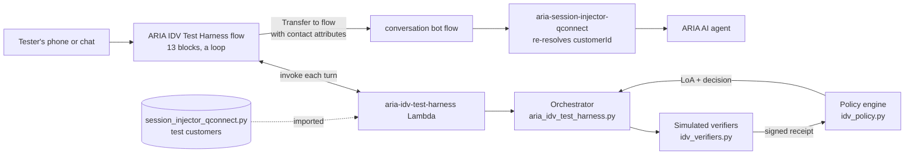

# Spec: ARIA ID&V Test Harness

| | |
|---|---|
| Status | Built and unit-tested locally. **Not deployed.** All AWS changes are manual (see [README.md](README.md)). |
| Source design | *CLI identification and caller verification on Amazon Connect* (8 Oct 2026) |
| Connect instance | `conversationbot` (`<instance-id>`, eu-west-2) |
| Hands over to | `conversation bot flow` (`f6d6545f-c9ae-4ca4-a4d8-6fdc8ba0494f`) |

## 1. Problem

Two things cannot be tested today.

1. **Any test customer from one phone.** `session_injector_qconnect.py` picks the customer from the
   caller's phone number. One handset is therefore always the same customer, and four of the five
   test customers are mapped to numbers nobody can call from.
2. **ID&V as designed.** The design document separates *identify*, *verify* and *authorise*, and says
   a phone number must never prove who is calling. The current build does the opposite: the injector
   sets `authStatus=authenticated` on a bare phone-number match.

## 2. Goals and non-goals

**Goals**

- A separate test flow that offers every customer the injector knows, whatever number the tester
  calls from, and hands the choice to the main flow as context.
- The main flow's injector re-resolves that customer itself (the "verified again" step).
- Every option in the design document (A to F) can be exercised by one tester with one phone.
- No change to the main flow. No change to deployed behaviour for contacts that skip the harness.

**Non-goals**

- Real push notifications, SMS, email, CAMARA calls, KMS signing or Cedar policies. All are simulated
  inside one Lambda. Section 9 maps each simulation to its production equivalent.
- Changing ARIA's AI prompt to behave differently at each assurance level. The harness delivers the
  level to the prompt; using it is follow-up work (section 10).
- Production use. The Lambda refuses to run unless explicitly enabled.

## 3. The mechanism everything depends on

`session_injector_qconnect.handler` reads `customerId` and `authStatus` from **contact attributes**
and only falls back to its phone-number table when `customerId` is empty. Contact attributes survive
a *Transfer to flow* block. The main flow's injector block passes no parameters, so attributes are
its only input.

So the harness needs to do exactly one thing to choose the customer: set `customerId` and
`authStatus` as contact attributes, then transfer to the main flow. The injector then looks the
customer up in its own registry (`_lookup_customer`) and builds the session context. An ID it does
not recognise gets base variables only. That lookup is the second verification.

## 4. Architecture

### 4.1 Why a Lambda-driven loop

The flow contains no ID&V logic. Each turn it invokes the Lambda, stores the reply as contact
attributes, and follows the reply's `action`: `input` (play the prompt, collect digits, invoke
again), `handoff` (play, transfer to the main flow) or `end` (play, disconnect).

| Considered | Outcome |
|---|---|
| One flow block per question and branch | Rejected. Around 80 blocks to build by hand, and flow logic cannot be unit-tested. |
| **Lambda state machine + 13-block loop** | **Chosen.** The whole dialogue is Python, covered by unit tests. The flow is small enough to build by hand. |
| Lex bot for the dialogue | Rejected. Adds a bot to build and train for what is a keypad-driven test tool. |

The Lambda is stateless. Conversation state travels in `idvState`, a signed string the flow stores
as a contact attribute and Connect returns in the next event. A state whose signature does not
verify is discarded and the dialogue restarts.

### 4.2 Separation of duties

The design's rule is "the AI agent orchestrates, verifiers prove, a deterministic policy engine
decides". The code keeps the same three roles in three files.

| File | Role | May change LoA? |
|---|---|---|
| `aria_idv_test_harness.py` | Runs the dialogue, picks the next step | No |
| `idv_verifiers.py` | Simulated CLI lookup, network signals, push, OTP, KBA. Success returns a signed receipt | No |
| `idv_policy.py` | `accept_receipt`, `evaluate`, `allowed_methods`. Pure functions, no I/O | **Yes, only here** |
| `idv_tokens.py` | HMAC signing helpers (standard library only) | No |
| `idv_test_data.py` | Imports customers from the injector; adds DOB, security number, app and line data | No |

There is one deliberate exception: **quick select** sets LoA3 with no receipt. It exists to meet the
first goal, and it is labelled `idvMethod=test_quick_select` with reason `TEST_QUICK_SELECT_BYPASS`.

## 5. Level of assurance and policy

| Level | Evidence | Granted by | Allows |
|---|---|---|---|
| LoA0 Anonymous | Nothing, several CLI matches, no CLI match, or a high-risk line | Harness | General information |
| LoA1 Identified | One CLI match on a low-risk line, or a resolved claimed identity | Harness | Nothing personal. ARIA treats it as unauthenticated |
| LoA2 Verified | One of: OTP, KBA, chat session token, app dial code from another phone | Harness | Account, card and mortgage information; card blocks. No payments |
| LoA3 Strongly verified | Push with number matching; app call token; in-app step-up; SMS OTP + KBA on own phone; dial code from the registered mobile | Harness | Everything ARIA can do except a payment |
| LoA4 Payment | LoA3 **plus** an app approval with number matching for that payment, validated by a tool | **ARIA, in the main flow** | Making one payment |

**The harness targets LoA3 on every contact** (`idv_policy.TARGET_LOA`). It does not ask what the
customer wants. If LoA3 cannot be reached it hands over at the level achieved and ARIA limits what
it offers. Earlier versions asked for an intent first and verified only as far as that intent
needed; that menu has been removed.

**LoA4 is never granted by the harness.** `accept_receipt` caps every receipt at 3, and a unit test
asserts it. LoA4 belongs to ARIA: on a payment request from an LoA3 customer it confirms payee and
amount, asks a scam-check question, calls `send_push_challenge`, reads out the two-digit match number,
and passes the number the customer reports to `verify_push_challenge`. Only `verified: true` from
that tool makes the customer LoA4, for that one payment. No knowledge questions are asked. The design's rule still holds: the agent runs the dialogue, a deterministic tool
decides.

Rules enforced in `idv_policy.py`:

- High risk removes SMS OTP, email OTP and KBA. Push is accepted only from a device bound before the
  SIM swap. Reaching LoA3 on a high-risk line attaches obligation `HOLD_72H`.
- A borrowed phone never receives the OTP. It goes to the claimed customer's email. Push is offered
  only if their app is on a second device.
- Email OTP + KBA stays at LoA2. SMS OTP + KBA on the caller's own registered phone reaches LoA3.
- The dialogue asks only for a factor that would raise the level. After an emailed code (LoA2) the
  security-number question is skipped, because email OTP + KBA is still LoA2.
- Push is offered once. OTP and KBA allow two attempts each.
- A receipt is rejected if its signature is wrong, it has expired, it was used before, or it is bound
  to another contact or customer.

Three choices that are easy to change:

- **Level before intent.** The source document asks what the customer wants first and verifies only
  as far as needed. This build verifies to LoA3 first, by request. It costs customers with simple
  questions an unnecessary check, and gains a simpler flow and a single hand-off point.
- **LoA4 is an app approval, simulated.** The step-up mirrors the harness: a push with number
  matching, bound to the payee and amount. Two things make it a simulation. No notification is
  sent, so the customer says the number aloud and ARIA relays it; ARIA has therefore seen the right
  answer before it calls the verifier, which a real deployment must never allow (the app reports to
  the push service directly). And the challenge is a stateless signed token, so it expires but is
  not single-use. A customer with no app cannot reach LoA4 and is offered a colleague.
- **LoA4 lives in the conversation.** ARIA cannot write contact attributes, so `LoA` on the contact
  stays 3. The only durable record is the `conversationSummary` on escalation, which begins
  "Level 4 payment step-up passed (app approval)."

## 6. Coverage of the design document

| Option | How the harness exercises it |
|---|---|
| A. CLI identifies, push verifies | Line = a customer's mobile. Ownership question, push with a two-digit match number, fallback to SMS OTP + KBA |
| B. Borrowed or shared phone | Answer "no" to ownership, or pick the shared number or withheld line. Claimed identity by date of birth + card last four. OTP by email |
| C. Network and risk signals | Daniel's line (SIM swap two days ago, divert on), or condition 2 on any line. Signals change which factors are offered |
| D. App-to-call handoff | `idvCallToken` contact attribute (in-app call), or mode 3 with a six-digit dial code (PSTN handoff) |
| E. Authenticated chat | `idvSessionToken` gives LoA2. `idvStepUpToken` gives LoA3. No token gives LoA0. KBA is never asked |
| F. Agentic ID&V with guardrails | The orchestrator cannot set LoA. Receipts claiming LoA4 are capped at 3 |

Conversation rules from the document that the unit tests assert: no name is spoken before a receipt
is accepted; failures never say which factor failed; the SIM swap, divert and risk score are never
spoken.

**Removed with the intent menu:** the harness no longer simulates protective actions at LoA1
(freeze card), a phone reported stolen, or third-party pressure. Those conversations now happen
with ARIA. **Not covered:** the "call me" variant of Option D, the Cognito *Authenticate Customer*
block, and Bedrock Guardrails screening of free speech.

## 7. Contracts

### 7.1 Lambda input

| Source | Field | Meaning |
|---|---|---|
| Block parameter | `operation` | `start` or `step` |
| Block parameter | `input` | `$.StoredCustomerInput`, or the literal `Timeout` |
| Contact attribute | `idvState` | Signed state from the previous turn |
| Contact attribute | `idvTestCustomerId` | Quick-select without the menu |
| Contact attribute | `idvCallToken`, `idvSessionToken`, `idvStepUpToken` | Options D and E |

Attributes are also read with the hosted widget's `HostedWidget-` prefix.

### 7.2 Lambda output and contact attributes

All values are strings, as Connect's `STRING_MAP` requires. Everything except `action` and `prompt`
is copied to a contact attribute after each turn.

| Key | Values | Read by |
|---|---|---|
| `action`, `prompt` | `input` / `handoff` / `end`; text to speak | The harness flow |
| `idvState` | Signed state | The Lambda, next turn |
| `customerId` | `CUST-00x`, or **empty below LoA2** | Injector |
| `authStatus` | `authenticated` at LoA2+, else `unauthenticated` | Injector, main flow |
| `LoA` | `0` to `3`. Never `4` | Injector (as `loa`), ARIA's prompt, contact record |
| `idvMethod` | `push`, `kba+otp_sms`, `app_handoff`, `test_quick_select`, ... | Injector |
| `cliRelationship` | `MATCH` / `MISMATCH` / `NONE` | Injector |
| `riskScore`, `reasonCodes` | `0` to `100`; comma-separated codes | Injector |
| `idvStatus` | `verified` / `identified` / `anonymous` | Injector (switches off its phone fallback) |
| `idvIntent`, `idvDecision`, `idvObligations`, `idvSummary` | Always `servicing`; `PERMIT` (LoA3 reached) / `DENY` / `STEP_UP`; obligations; one-line summary | Contact record |

`customerId` is withheld below LoA2 on purpose. The design calls this disclosure tied to level: the
AI agent cannot read out a name it never received. The harness never sets `entry`, because
`entry=web_widget` diverts the main flow to the mortgage handover.

### 7.3 Session injector changes

`scripts/lambdas/session_injector_qconnect.py` (and the same logic in `session_injector.py`):

- When `idvStatus` is present and `customerId` is empty, skip the phone-number fallback. Without
  this, a caller the harness left unverified is re-authenticated by CLI in the main flow.
- When `idvStatus` is present, inject `loa`, `idvStatus`, `idvMethod`, `cliRelationship`, `riskScore`
  and `reasonCodes` as `{{$.Custom.*}}`.
- **Opt-in: `CLI_MATCH_LOA`.** By default a direct call recognised by phone number earns no level:
  it is greeted by name, as before, but gets no contact reasons and cannot start a payment. Setting
  `CLI_MATCH_LOA=3` (deploy flag `--cli-match-loa 3`) gives such a caller level 3 with
  `idvMethod=cli_match`, so a direct call behaves like one that came through the harness. An ID&V
  result from upstream always wins over the phone match. This is for test and demo use only.

## 8. Security

- **Kill switch.** The Lambda returns `HARNESS_DISABLED` unless `IDV_TEST_HARNESS_ENABLED=true`.
- **Least privilege.** The role has CloudWatch Logs only. The Lambda calls no AWS API. The invoke
  permission is scoped to the Connect instance ARN when `--instance-id` is given.
- **Signed state and tokens.** HMAC-SHA256 with `IDV_TEST_SIGNING_SECRET` (16+ characters).
- **Fictional data only.** Dates of birth and security numbers are invented for the five stub
  customers. Never add real customer data.
- **Known limits, acceptable for a test tool:**
  - The signing secret is a Lambda environment variable, readable by anyone who can view the function.
  - `idvState` is signed but not encrypted. It is visible in contact attributes and flow logs, and it
    contains the candidate customer ID before verification.
  - Call tokens are time-limited (five minutes) but not single-use, because the Lambda has no store.
    Production needs a conditional write to make a token one-time.
  - Anyone who can dial the number assigned to this flow can use quick select. Use a number that is
    not published, and switch the harness off when not testing.

## 9. Simulation to production

| Harness | Production |
|---|---|
| `lookup_by_cli` over the injector's phone table | Identity graph / CIF, hashed CLI index |
| `get_network_signals` from profile flags | CAMARA SIM Swap, Call Forwarding, KYC Tenure via operator or aggregator |
| Push: tester keys the match number | Push authentication service, device-bound key, biometric |
| OTP: code read out by the harness | SMS / email OTP service, suppressed on SIM swap |
| KBA: 2nd and 5th digit of a stub number | Partial PIN service, hashed, rate-limited |
| HMAC receipts | Receipts signed with a KMS key the agent cannot use |
| `idv_policy.py` | Cedar policies in Amazon Verified Permissions |
| `mint_test_token.py` | Mobile BFF minting a one-time call token; chat BFF session JWS |
| Keypad menus | ARIA orchestrator agent calling these as MCP tools |

## 10. Findings in the existing build

Observed while reading the instance. Nothing here was changed.

1. **CLI authenticates on its own.** On a direct call the injector treats a phone-number match as
   `authStatus=authenticated`, and ARIA reads out the customer's products on that basis. The design
   document says CLI is at most LoA1, because a number can be borrowed, shared or spoofed. By
   default this build gives a phone match no level of assurance, so contact reasons and payments
   stay behind real ID&V. The `CLI_MATCH_LOA` opt-in removes that protection for direct calls: with
   it set to 3, anyone calling from a recognised number is offered that customer's contact reasons,
   including a fraud-related one, and can start a payment approval. Use it only for testing. For
   production, put a real ID&V flow in front of the main flow.
2. **The main flow invokes the injector's unqualified ARN** (`$LATEST`), while a `prod` alias exists
   at version 6. Deploying new injector code takes effect in the main flow immediately.
3. **The main flow creates the Q Connect session twice**: once with the orchestration agent
   configuration before the injector, and once without it after. Session data is injected in between.
   Worth confirming the second block does not discard the injected data.
4. **The deployed injector dates from 28 April 2026.** Whether it matches the repository source was
   not checked, because reading deployed code needs a download this session did not make.

## 11. Verification status

| Check | Result |
|---|---|
| Unit tests (`python3 -m unittest discover -s connect-idv-test-harness/tests`) | 67 pass |
| Flow JSON structural validation | Pass, no placeholders |
| Deploy script | `bash -n` syntax check only. Not run |
| Flow imported into Connect | **Not done** |
| End-to-end call or chat | **Not done** |

Two behaviours can only be confirmed on a live contact: whether keypad input works on in-app
(WebRTC) calls, and how Connect's text-to-speech handles the longer menus.

Empty Lambda values are not a concern. The main flow already copies empty `$.External` values
(`priorChannel`, `vulnerabilityContext`) into attributes on every call, and the harness never
replaces a set value with an empty one: `customerId` stays empty until LoA2, and the level never
falls within a contact.

## 12. Follow-up work

- Decide finding 1: should a CLI match alone still authenticate in the main flow?
- Use `{{$.Custom.loa}}` in ARIA's orchestration prompt so the agent's disclosures follow the level.
- Replace keypad menus with the orchestrator agent calling the verifiers as MCP tools (Option F proper).
- Make call tokens single-use with a DynamoDB conditional write.
