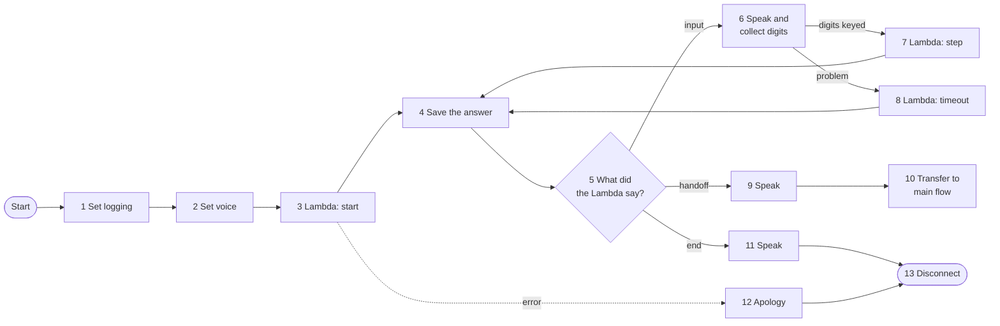

# Build the ARIA IDV Test Harness Flow by Hand — Block by Block

This guide builds the same flow as [aria-idv-test-harness-flow.json](aria-idv-test-harness-flow.json),
one block at a time, in the Amazon Connect flow designer. Use it instead of importing the JSON if
you want to **learn how the flow works** by making it yourself.

It takes about 45 minutes. You do not need to have built a flow before.

> **About the screen labels.** This guide was written from the AWS documentation and from the flow
> JSON, not by clicking through your console. Amazon renames buttons from time to time, so a label
> may differ slightly from what you see (for example *AWS Lambda function* was once *Invoke AWS
> Lambda function*). The block names, settings and values are what matter. If something does not
> match, the [official block reference](https://docs.aws.amazon.com/connect/latest/adminguide/contact-block-definitions.html)
> shows the current screen for every block.

---

## Table of Contents

- [Before You Start](#before-you-start)
- [The Idea in One Picture](#the-idea-in-one-picture)
- [Five Things to Know About the Designer](#five-things-to-know-about-the-designer)
- [Step 1 — Create an Empty Flow](#step-1--create-an-empty-flow)
- [Step 2 — Build the 13 Blocks](#step-2--build-the-13-blocks)
- [Step 3 — Check Every Connection](#step-3--check-every-connection)
- [Step 4 — Save and Publish](#step-4--save-and-publish)
- [Step 5 — Prove It Matches the JSON](#step-5--prove-it-matches-the-json)
- [Common Mistakes](#common-mistakes)
- [Learn More by Breaking It](#learn-more-by-breaking-it)

---

## Before You Start

You need these in place first. Each is covered in the main [README](../README.md).

| Needed | Where | How to check |
|---|---|---|
| The Lambda `aria-idv-test-harness` exists | README Part B | It appears in the AWS Lambda console |
| The Lambda is on the Connect instance's allow-list | README Part C | It appears in the function drop-down in Block 3 below |
| The main flow `conversation bot flow` exists and is published | Already true in your instance | **Routing → Flows** lists it |

If the Lambda does not appear in the drop-down in Block 3, stop and finish README Part C. You cannot
work around it.

---

## The Idea in One Picture

Most flows are a tree: ask a question, branch, ask another, branch again. This one is a **loop**.
It has no questions of its own. It keeps asking a Lambda "what should I do next?"



Read it as a conversation between two parties:

| Turn | The flow | The Lambda |
|---|---|---|
| 1 | "A call has started." (Block 3) | "Say *press 1 for quick select...* and collect digits." (`action = input`) |
| 2 | Speaks, collects `1`, sends it. (Blocks 6, 7) | "Say *choose the customer...* and collect digits." (`action = input`) |
| 3 | Speaks, collects `3`, sends it. | "Say *handing over as Margaret* and transfer." (`action = handoff`) |
| 4 | Speaks, transfers to the main flow. (Blocks 9, 10) | |

Blocks 4 → 5 → 6 → 7 → 4 form the loop. A call may go round it twice or fifteen times, depending on
the test. The flow does not know or care.

**Why build it this way?** If every question were its own block, the flow would need roughly 80
blocks and you could not test the logic without making phone calls. With a loop, the logic is Python
that runs on a laptop, and the flow stays small enough to build in one sitting.

---

## Five Things to Know About the Designer

1. **The palette is on the left.** It lists every block type. Use its search box.
2. **Drag a block onto the canvas**, then click the block's title to open its settings panel on the
   right. Click **Save** in that panel when done. This saves the block, not the flow.
3. **Blocks have outputs called branches**, shown as small circles on the block's right edge:
   usually **Success** and **Error**. Drag from a circle to another block to connect them.
4. **Every branch must go somewhere.** The designer refuses to publish a flow with a loose branch.
5. **An arrow can point backwards.** That is how a loop is made. Nothing special is needed.

**What "Set dynamically" means.** Many settings let you either type a value (*Set manually*) or
read it from somewhere while the call is running (*Set dynamically*). A dynamic value has two parts:

| Part | Meaning | Examples used in this flow |
|---|---|---|
| **Namespace** | Which group of values to read from | **External** = the answer from the last Lambda. **System** = values Connect provides. **User defined** = contact attributes you set |
| **Key** | Which value in that group | `prompt`, `action`, `Stored customer input` |

So "External, key `prompt`" means: *the `prompt` field in the Lambda's most recent answer*. In the
JSON file the same thing is written as `$.External.prompt`.

---

## Step 1 — Create an Empty Flow

1. Open your Connect admin website.
2. Left menu → **Routing** → **Flows**.
3. Click **Create flow**.
4. Select type: **Contact flow (inbound)**.
5. Name it: `ARIA IDV Test Harness`
6. Description: `TEST ONLY. Pick a test customer, run ID&V, hand over to conversation bot flow.`

The canvas opens with a single **Start** entry point (also labelled *Entry*) at the top left.

> **Tip: place first, wire second.** Because this flow loops back on itself, it is easiest to drag
> all 13 blocks onto the canvas in a rough left-to-right row, configure each one, and only then draw
> the arrows. The steps below describe each block's connections as you go, but if a block you need
> to connect to does not exist yet, carry on and come back.

Suggested layout, so your canvas resembles the diagram above:

```
Row 1 (top):     12 Apology    11 Goodbye                         13 Disconnect
Row 2 (middle):  1 → 2 → 3 → 4 → 5 → 9 Handoff → 10 Transfer
Row 3 (bottom):          7 Step              6 Collect input
Row 4:                   8 Timeout
```

---

## Step 2 — Build the 13 Blocks

Each block below has the same sections: what it is, why it is here, the steps, where its branches
go, and the matching name in the JSON file.

### Block 1: Set Logging Behavior

**What it is**: Switches on flow logs in Amazon CloudWatch.

**Why you need it**: When a test call does something unexpected, the flow log shows which block ran,
which branch it took and what the Lambda returned. Without it you are guessing.

> Official docs: [Set logging behavior](https://docs.aws.amazon.com/connect/latest/adminguide/set-logging-behavior.html)

**Steps**:
1. Search the palette for **Set logging behavior** and drag it onto the canvas.
2. Connect the **Start** entry point → this block.
3. Click the block. Choose **Enable**.
4. Click **Save**.

**Connect next**: **Success** → Block 2

**In the JSON**: `EnableLogging`, type `UpdateFlowLoggingBehavior`

---

### Block 2: Set Voice

**What it is**: Chooses the voice that reads text aloud.

**Why you need it**: The main flow uses the voice *Amy*. Using the same voice here means the caller
does not hear the voice change at handover. On a chat contact this block has no effect.

> Official docs: [Set voice](https://docs.aws.amazon.com/connect/latest/adminguide/set-voice.html)

**Steps**:
1. Search for **Set voice** and drag it on.
2. Click the block.
3. **Language**: `English (British)`
4. **Voice**: `Amy`
5. **Engine** (or *speaking style*): `Generative`
6. Click **Save**.

**Connect next**:
- **Success** → Block 3
- **Error** → Block 3 *(a voice problem should not stop the test; the default voice is used instead)*

**In the JSON**: `SetVoice`, type `UpdateContactTextToSpeechVoice`

---

### Block 3: AWS Lambda Function — Start

**What it is**: Calls the harness Lambda for the first time and tells it a contact has begun.

**Why you need it**: This is turn 1 of the conversation in the table above. The Lambda looks at the
contact (voice or chat, any test attributes) and answers with the first thing to say.

> Official docs: [AWS Lambda function block](https://docs.aws.amazon.com/connect/latest/adminguide/invoke-lambda-function-block.html)

**Steps**:
1. Search for **AWS Lambda function** and drag it on.
2. Click the block.
3. **Select a function**: choose `aria-idv-test-harness`.
   *(Not in the list? Finish README Part C, then refresh this page.)*
4. **Execution mode**: **Synchronous** *(the flow waits for the answer; it cannot continue without it)*
5. **Timeout**: `8` seconds
6. **Response validation**: `STRING_MAP`
   *(This promises Connect that the Lambda returns simple name-and-text pairs, which lets later
   blocks read each one by name.)*
7. Under **Function input parameters** (or *Send parameters*), click **Add a parameter**:

| Destination key | How to set | Value |
|---|---|---|
| `operation` | Set manually | `start` |

8. Click **Save**.

**Connect next**:
- **Success** → Block 4
- **Error** → Block 12 *(and **Timeout** → Block 12, if your console shows that branch)*

**In the JSON**: `StartHarness`, type `InvokeLambdaFunction`

> **What comes back?** Fifteen named values. The two that drive this flow are `action` (what to do)
> and `prompt` (what to say). Until the next Lambda block runs, any block can read them from the
> **External** namespace.

---

### Block 4: Set Contact Attributes — Save the Answer

**What it is**: Copies the Lambda's answer into **contact attributes**, which are values attached to
the contact for its whole life.

**Why you need it**: Three reasons.

1. **Memory.** The Lambda remembers nothing between calls. It packs everything it needs to continue
   into one value, `idvState`. This block stores it, and Connect hands it back to the Lambda
   automatically on the next turn. Without this block, every turn would start from the beginning.
2. **Handover.** The main flow's session injector reads `customerId` and `authStatus` from contact
   attributes. This block is what puts them there.
3. **Evidence.** Attributes appear on the contact record, so after a test you can see the level
   reached and why.

> Official docs: [Set contact attributes](https://docs.aws.amazon.com/connect/latest/adminguide/set-contact-attributes.html)

**Steps**:
1. Search for **Set contact attributes** and drag it on.
2. Click the block.
3. **Set attributes on**: **Current contact**
4. Add **13** attributes. For each one click **Add another attribute**, then:
   - **Namespace** (destination): `User defined`
   - **Key** (destination): the name in the table
   - **Value**: **Set dynamically** → Namespace `External` → Key: the same name

| # | Destination key | Value: External key | What it holds |
|---|---|---|---|
| 1 | `idvState` | `idvState` | The harness's memory |
| 2 | `customerId` | `customerId` | Who the caller is (empty until verified) |
| 3 | `authStatus` | `authStatus` | `authenticated` or `unauthenticated` |
| 4 | `LoA` | `LoA` | Level of assurance, 0 to 3 |
| 5 | `idvMethod` | `idvMethod` | How they were verified |
| 6 | `cliRelationship` | `cliRelationship` | `MATCH`, `MISMATCH` or `NONE` |
| 7 | `riskScore` | `riskScore` | 0 to 100 |
| 8 | `reasonCodes` | `reasonCodes` | Why each decision was made |
| 9 | `idvStatus` | `idvStatus` | `verified`, `identified` or `anonymous` |
| 10 | `idvIntent` | `idvIntent` | What the caller asked for |
| 11 | `idvDecision` | `idvDecision` | `PERMIT`, `STEP_UP` or `DENY` |
| 12 | `idvObligations` | `idvObligations` | Conditions attached to a permit |
| 13 | `idvSummary` | `idvSummary` | One-line summary |

5. Click **Save**.

> **Type these exactly.** Capital letters matter. `customerId` and `authStatus` must match what the
> session injector looks for. `idvState` must match what the harness Lambda looks for. `LoA` has a
> capital L and A. A misspelt key does not cause an error: the value is simply stored under the
> wrong name and never found.

**Connect next**:
- **Success** → Block 5
- **Error** → Block 12

**In the JSON**: `SaveResult`, type `UpdateContactAttributes`

---

### Block 5: Check Contact Attributes — What Did the Lambda Say?

**What it is**: A fork. It reads one value and sends the contact down the matching branch.

**Why you need it**: This is where the flow obeys the Lambda. The Lambda's `action` is always one of
three words, and each has its own branch.

> Official docs: [Check contact attributes](https://docs.aws.amazon.com/connect/latest/adminguide/check-contact-attributes.html)

**Steps**:
1. Search for **Check contact attributes** and drag it on.
2. Click the block.
3. **Attribute to check**: Namespace `External`, Key `action`
4. Click **Add another condition** three times and fill in:

| Condition | Value |
|---|---|
| Equals | `input` |
| Equals | `handoff` |
| Equals | `end` |

5. Click **Save**. The block now shows four branches.

**Connect next**:
- **input** → Block 6 *(the Lambda wants digits from the caller)*
- **handoff** → Block 9 *(the Lambda has finished; go to ARIA)*
- **end** → Block 11 *(the Lambda wants to stop)*
- **No match** → Block 11 *(anything unexpected: say goodbye rather than loop forever)*

**In the JSON**: `CheckAction`, type `Compare`

> **Why read `action` from External and not from the attributes saved in Block 4?** Block 4 does not
> save `action` or `prompt`, on purpose. They describe one turn only and would be stale on the next.
> The External values are still available here because no other Lambda has run since Block 3 or 7.

---

### Block 6: Store Customer Input — Speak and Collect Digits

**What it is**: Speaks a prompt, then waits for the caller to key digits on their phone.

**Why you need it**: It is the caller's half of each turn. The prompt is whatever the Lambda just
supplied, so this single block asks every question in the harness.

**Why this block and not "Get customer input"?** *Get customer input* accepts a single key press and
branches on it. The harness needs several digits at once (an 8-digit date of birth, a 6-digit code),
which only *Store customer input* can collect.

> Official docs: [Store customer input](https://docs.aws.amazon.com/connect/latest/adminguide/store-customer-input.html)

**Applies to**: Voice only. On chat the Lambda never returns `input`, so this block is never reached.

**Steps**:
1. Search for **Store customer input** and drag it on.
2. Click the block.
3. **Prompt**: choose **Text-to-speech or chat text**, then **Set dynamically**:
   Namespace `External`, Key `prompt`
4. **Interpret as**: `Text`
5. **Customer input**: choose **Custom**, **Maximum digits**: `12`
6. **Timeout before first entry**: `10` seconds
7. **Encrypt entry**: leave **unticked** *(these are test digits, and the Lambda must read them)*
8. **Specify terminating keypress**: tick it and enter `#`
9. **Disable cancel key**: leave unticked
10. Click **Save**.

**Connect next**:
- **Success** → Block 7
- **Error** → Block 8

**In the JSON**: `CollectInput`, type `GetParticipantInput` with `StoreInput` set to `True`

> **What if the caller keys nothing?** The block still takes the **Success** branch, and the stored
> value is the word `Timeout`. The Lambda understands that word. For a push notification test,
> silence means "the customer never responded", which is a real scenario you will want to try.

---

### Block 7: AWS Lambda Function — Step

**What it is**: Calls the same Lambda again, this time passing the digits the caller keyed.

**Why you need it**: It closes the loop. The Lambda reads the digits and its saved `idvState`,
decides what happens next, and answers with a new `action` and `prompt`.

**Steps**:
1. Drag on another **AWS Lambda function** block.
2. Click the block.
3. **Select a function**: `aria-idv-test-harness`
4. **Execution mode**: **Synchronous**. **Timeout**: `8` seconds. **Response validation**: `STRING_MAP`
5. Add **two** parameters:

| Destination key | How to set | Value |
|---|---|---|
| `operation` | Set manually | `step` |
| `input` | **Set dynamically** | Namespace `System`, Key `Stored customer input` |

6. Click **Save**.

**Connect next**:
- **Success** → **Block 4** *(this backward arrow is the loop)*
- **Error** → Block 12

**In the JSON**: `StepHarness`, type `InvokeLambdaFunction`

> **The most common mistake in this whole flow** is setting `input` *manually* and typing the words
> "Stored customer input". The Lambda then receives that text instead of the digits and replies
> "Sorry, I didn't get that" forever. It must be **Set dynamically → System**.

> **You did not pass `idvState` as a parameter, so how does the Lambda get it?** Connect sends every
> contact attribute to the Lambda automatically, inside the event. Block 4 saved `idvState` as a
> contact attribute, so it arrives without being listed here.

---

### Block 8: AWS Lambda Function — Timeout

**What it is**: The same Lambda call as Block 7, but it sends the fixed word `Timeout` instead of
the stored digits.

**Why you need it**: It handles Block 6's **Error** branch. If collecting input fails, the stored
value may still hold digits from an *earlier* question. Sending those again would answer the new
question with an old answer. Sending the word `Timeout` is always safe: the Lambda repeats the
question, or treats it as silence.

**Steps**:
1. Drag on a third **AWS Lambda function** block.
2. Configure it exactly as Block 7, with these parameters:

| Destination key | How to set | Value |
|---|---|---|
| `operation` | Set manually | `step` |
| `input` | Set manually | `Timeout` |

3. Click **Save**.

**Connect next**:
- **Success** → **Block 4**
- **Error** → Block 12

**In the JSON**: `StepTimeout`, type `InvokeLambdaFunction`

---

### Block 9: Play Prompt — Handover Message

**What it is**: Speaks text (or sends it as a chat message).

**Why you need it**: Before transferring, the harness tells you what it is handing over, for
example *"handing over to ARIA as Margaret, level 3, method test quick select"*. You hear the
outcome without opening the contact record.

> Official docs: [Play prompt](https://docs.aws.amazon.com/connect/latest/adminguide/play.html)

**Steps**:
1. Search for **Play prompt** and drag it on.
2. Click the block.
3. Choose **Text-to-speech or chat text**, then **Set dynamically**: Namespace `External`, Key `prompt`
4. **Interpret as**: `Text`
5. Click **Save**.

**Connect next**:
- **Success** → Block 10
- **Error** → Block 10 *(a failed announcement must not stop the handover)*

**In the JSON**: `SayHandoff`, type `MessageParticipant`

---

### Block 10: Transfer to Flow — Hand Over to ARIA

**What it is**: Moves the contact into another flow. The contact keeps all its contact attributes.

**Why you need it**: This is the purpose of the whole harness. The contact arrives at the top of
`conversation bot flow` carrying `customerId`, `authStatus`, `LoA` and the rest. That flow's session
injector reads `customerId`, looks the customer up in its own list, and builds ARIA's context.

> Official docs: [Transfer to flow](https://docs.aws.amazon.com/connect/latest/adminguide/transfer-to-flow.html)

**Steps**:
1. Search for **Transfer to flow** and drag it on.
2. Click the block.
3. **Select a flow** → **Set manually** → choose `conversation bot flow`
4. Click **Save**.

**Connect next**:
- **Error** → Block 13

There is no Success branch. A successful transfer leaves this flow and does not come back.

**In the JSON**: `TransferToMain`, type `TransferToFlow`

> **Only published flows appear in the list.** If `conversation bot flow` is missing, it has unsaved
> or unpublished changes. Publish it first.

---

### Block 11: Play Prompt — Goodbye

**What it is**: A second Play prompt, used when the Lambda returns `end`.

**Why you need it**: The Lambda ends a contact when it is switched off, is missing its secret, or
received no usable input three times in a row. In each case it supplies a sentence explaining why.

**Steps**:
1. Drag on another **Play prompt** block.
2. Configure it exactly as Block 9: **Set dynamically**, Namespace `External`, Key `prompt`.
3. Click **Save**.

**Connect next**:
- **Success** → Block 13
- **Error** → Block 13

**In the JSON**: `SayGoodbye`, type `MessageParticipant`

---

### Block 12: Play Prompt — Apology

**What it is**: A Play prompt with **fixed** text.

**Why you need it**: This is where the flow lands if a Lambda block or Block 4 fails. It cannot use
the Lambda's `prompt`, because the Lambda is what failed. So the text is typed in.

**Steps**:
1. Drag on a third **Play prompt** block.
2. Choose **Text-to-speech or chat text** → **Set manually**.
3. Enter: `Sorry, the test harness is not available right now. Goodbye.`
4. Click **Save**.

**Connect next**:
- **Success** → Block 13
- **Error** → Block 13

**In the JSON**: `HarnessError`, type `MessageParticipant`

---

### Block 13: Disconnect / Hang Up

**What it is**: Ends the contact.

**Why you need it**: Every path that does not transfer must end somewhere. One Disconnect block can
receive any number of arrows.

**Steps**:
1. Search for **Disconnect / hang up** and drag it on.
2. It has no settings.

**Connect next**: nothing. It has no outputs.

**In the JSON**: `Disconnect`, type `DisconnectParticipant`

---

## Step 3 — Check Every Connection

Before saving, check each arrow against this list. There are 23.

| From | Branch | To |
|---|---|---|
| Start | | 1 Set logging |
| 1 Set logging | Success | 2 Set voice |
| 2 Set voice | Success | 3 Lambda start |
| 2 Set voice | Error | 3 Lambda start |
| 3 Lambda start | Success | 4 Save the answer |
| 3 Lambda start | Error | 12 Apology |
| 4 Save the answer | Success | 5 Check action |
| 4 Save the answer | Error | 12 Apology |
| 5 Check action | `input` | 6 Collect input |
| 5 Check action | `handoff` | 9 Handover message |
| 5 Check action | `end` | 11 Goodbye |
| 5 Check action | No match | 11 Goodbye |
| 6 Collect input | Success | 7 Lambda step |
| 6 Collect input | Error | 8 Lambda timeout |
| 7 Lambda step | Success | **4 Save the answer** |
| 7 Lambda step | Error | 12 Apology |
| 8 Lambda timeout | Success | **4 Save the answer** |
| 8 Lambda timeout | Error | 12 Apology |
| 9 Handover message | Success | 10 Transfer |
| 9 Handover message | Error | 10 Transfer |
| 10 Transfer | Error | 13 Disconnect |
| 11 Goodbye | Success / Error | 13 Disconnect |
| 12 Apology | Success / Error | 13 Disconnect |

The two rows in bold are the backward arrows that make the loop. If either points at Block 5
instead of Block 4, the harness loses its memory every turn and restarts the menu.

---

## Step 4 — Save and Publish

1. Click **Save** (top right). This stores your work but callers do not get it yet.
2. If a message says a block has an unconnected branch, find it with the list in Step 3.
3. Click **Publish**. The flow is now live for any phone number pointed at it.

Then continue with [README Part E](../README.md#part-e--point-a-test-phone-number-at-the-flow) to
assign a test number, and [Part G](../README.md#part-g--your-first-call) to make your first call.

---

## Step 5 — Prove It Matches the JSON

You can check your hand-built flow against the reference file.

1. In the flow designer, click the arrow next to **Save** → **Export flow**. A `.json` file downloads.
2. Open it beside [aria-idv-test-harness-flow.json](aria-idv-test-harness-flow.json).

Do not expect the files to be identical. Three differences are normal:

| Difference | Why |
|---|---|
| Your block identifiers are long codes such as `2bc2649b-fe7e-...` | The designer generates IDs. The reference file uses readable names |
| The `position` numbers differ | They only record where blocks sit on the canvas |
| Blocks are listed in a different order | Order in the file has no meaning. The arrows define the flow |

What **should** match, block for block:

| Look for | It should be |
|---|---|
| Number of entries under `Actions` | 13 |
| `Type` values | 3 × `InvokeLambdaFunction`, 3 × `MessageParticipant`, and one each of `UpdateFlowLoggingBehavior`, `UpdateContactTextToSpeechVoice`, `UpdateContactAttributes`, `Compare`, `GetParticipantInput`, `TransferToFlow`, `DisconnectParticipant` |
| `LambdaFunctionARN` in all three Lambda blocks | ends in `function:aria-idv-test-harness` |
| `LambdaInvocationAttributes` | `{"operation":"start"}`, `{"operation":"step","input":"$.StoredCustomerInput"}`, `{"operation":"step","input":"Timeout"}` |
| `Attributes` in the `UpdateContactAttributes` block | 13 entries, each `"name": "$.External.name"` |
| `ComparisonValue` in the `Compare` block | `$.External.action` |
| `Text` in the `GetParticipantInput` block and two `MessageParticipant` blocks | `$.External.prompt` |
| `StoreInput` | `"True"` |
| `ContactFlowId` in `TransferToFlow` | ends in the ID of `conversation bot flow` |

One more difference is harmless: the reference file sends Block 6's *input time limit exceeded*
error to Block 8, as well as its general error. The designer may show only one Error branch for this
block. Both lead to Block 8, so the behaviour is the same.

---

## Common Mistakes

| Symptom on a call | Cause | Fix |
|---|---|---|
| "The test harness is not available right now" straight away | Block 3 failed. Usually the Lambda is not on the allow-list, or the wrong function is selected | README Part C. Recheck Block 3 |
| The first menu repeats after every key press | `idvState` not saved, or Blocks 7 and 8 point at Block 5 | Check the spelling in Block 4. Point 7 and 8 at Block 4 |
| "Sorry, I didn't get that" whatever you key | Block 7's `input` was set manually | Set dynamically → System → Stored customer input |
| Silence where a question should be | Block 6's prompt was set manually, or reads the wrong key | Set dynamically → External → `prompt` |
| The call drops instead of asking a question | Block 5's `input` branch is not connected to Block 6, or the condition is misspelt | Conditions must be exactly `input`, `handoff`, `end`, in lower case |
| Handover works but ARIA does not know the customer | `customerId` misspelt in Block 4 | It must be `customerId`, with a capital I |
| Every answer needs a long wait before it is accepted | No terminating key set in Block 6 | Tick *Specify terminating keypress*, enter `#` |
| Cannot publish: "unconnected branch" | A Success or Error circle has no arrow | Use the list in Step 3 |

To see exactly what happened on a call, open **CloudWatch → Log groups** and find the group for
your instance's flow logs (its name contains your instance alias, `conversationbot`). Each log line
names the block that ran and the branch it took. This works because of Block 1.

---

## Learn More by Breaking It

Once the flow works, change one thing at a time, publish, call, and see what happens. Put each
change back before trying the next.

| Try this | What you will learn |
|---|---|
| Remove `idvState` from Block 4 | Why the Lambda needs the flow to hold its memory. The first menu repeats forever |
| Point Block 7's Success at Block 5 instead of Block 4 | The same symptom from a different cause: the answer is acted on but never saved |
| Remove `customerId` from Block 4, then use quick select | ARIA no longer knows the customer and you arrive anonymous. (If you skipped README Part F and your own number is in the injector's table, you arrive as *that* customer instead, which shows why Part F matters) |
| Change Block 6's timeout to `3` seconds | How little time a caller has, and why the push test uses silence as an answer |
| Delete the `handoff` condition in Block 5 | Where unknown values go: the *No match* branch, so the call ends politely instead of looping |
| Change Block 10 to a different flow | The harness is not tied to one main flow. It can front any flow that reads `customerId` |

The last row is worth remembering. Nothing in this flow is specific to ARIA except the name of the
flow in Block 10 and the attribute names in Block 4.
